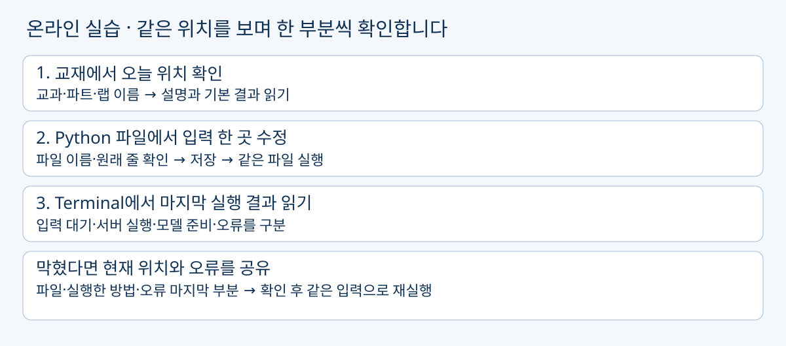

# 온라인 수업에서 실습하는 방법

[← 이번 교과 목차](README.md) · [자료·환경 준비](setup/README.md)

교재 화면, 코드를 고치는 화면, 실행 결과가 나오는 화면은 역할이 다릅니다. 선생님 화면과 내 화면의 메뉴 위치가 조금 달라도 **같은 교과·파일·입력·실행 결과**를 확인하면 됩니다. 모든 학생이 같은 속도로 진행할 필요는 없습니다.



## 화면 한 개로도 진행할 수 있습니다

README는 브라우저나 VS Code 미리 보기로 읽습니다. 코드는 VS Code의 .py 파일을 열어 고치고 결과는 아래 Terminal에서 읽습니다. 창을 옆으로 배치하거나 탭을 오가며 사용합니다. 작은 글자가 잘 안 보이면 편한 크기로 조정합니다. 화면을 여러 개 준비할 필요는 없습니다.

| 교재에서 본 것 | 어디에 사용하나요? |
|---|---|
| Python 코드 | 안내된 .py 파일에 입력·수정 |
| py·python·python3로 시작하는 실행 명령 | VS Code 아래 Terminal에 입력 |
| powershell/bash 표시 | 명령 예제의 구분 이름. 그 단어까지 복사하지 않음 |
| 예상 출력 | 실행 결과와 비교. Python 파일에 붙이지 않음 |
| JSON 요청 본문 · 04 이후 해당 활동 | API 시험 화면인 Swagger의 Request body에 입력. 00에서 별도 준비하지 않음 |

따옴표·들여쓰기를 유지하고 코드 블록 경계의 백틱은 복사하지 않습니다. 위에서부터 필요한 줄만 바꾸고 저장합니다. 같은 변수 줄을 파일 아래에 중복으로 추가하지 않습니다.

## 실행 버튼과 터미널 명령

옵션 없는 Python 예제는 ▶ Run Python File in Terminal로 실행합니다. 옵션이 있는 예제는 안내된 터미널 명령을 사용합니다. Markdown을 연 상태에서 Python 실행 버튼을 누르지 않습니다. 명령은 현재 교과 최상위에서 실행하는지 먼저 봅니다.

00은 기본 Python만 사용합니다. 가상환경과 외부 패키지는 01부터 교과별 안내로 준비합니다. 가상환경 생성·설치를 날짜마다 반복하거나 이전 교과의 .venv를 복사하지 않습니다. 자동 선택이 잘 동작하면 Python 선택 메뉴를 매번 열 필요는 없습니다. 모듈 오류가 날 때만 해당 교과 SETUP을 확인합니다.

## 멈춘 것처럼 보일 때 구분합니다

| 화면 상태 | 뜻과 다음 행동 |
|---|---|
| Terminal 끝에 ‘이름>’, ‘고객 문의>’ 같은 질문 | input 입력 대기. Terminal을 클릭해 값을 쓰고 Enter |
| ‘문의 입력 / list / q>’ 또는 메뉴 | 실행 중인 프로그램의 입력란. 종료는 그 프로그램 안내의 q 사용 |
| 터미널이 >>>로 시작 | Python 대화형 창. 파일 실행 명령을 적을 곳이 아님. exit()로 나오기 |
| 서버 실행 문구가 보이며 입력칸으로 안 돌아옴 | 웹 서버가 켜진 상태일 수 있음. 안내한 브라우저 주소 열기 |
| 토크나이저·모델 준비 또는 학습 진행 문구 | 다운로드·로딩·학습 중. 완료·실제 응답·저장 문구를 구분 |
| Traceback 또는 오류 안내 | 반복 클릭보다 오류 마지막 부분과 실행 위치 확인 |

서버나 모델을 같은 터미널에서 다시 켜려고 계속 실행하지 않습니다. 중지가 필요하면 해당 터미널에서 Ctrl+C를 사용합니다. 그다음 명령을 입력할 수 있는지 확인합니다. 종료된 서버는 브라우저 새로 고침만으로 다시 켜지지 않습니다. 설치·학습이 중단되었다면 완료했다고 기록하지 않습니다.

## 질문할 때 같은 위치를 알려 주세요

아래 항목 중 확인한 내용으로 질문하면 선생님이 같은 파일을 찾기 쉽습니다. 스크린샷 대신 오류 문장을 복사해도 됩니다. 화면 공유·채팅에는 API 키·비밀번호·실제 고객 정보를 가립니다.

```text
교과 / 학습 구간 / 랩:
운영체제: Windows 또는 macOS
열어 둔 Python 파일:
실행 방법: ▶ 또는 입력한 명령
마지막으로 성공한 것:
오류: 마지막 3~5줄, 길면 오류 종류와 마지막 줄
```

질문을 정리하는 동안 가능한 활동은 코드의 입력값·예상 결과를 읽거나 기본 데모를 확인하는 것입니다. 설치가 막힌 상태와 코드가 틀린 상태를 구분합니다. 선생님 화면을 봤다면 내 PC의 실제 성공과도 구분해 기록합니다.

## 수업에 다시 들어왔을 때

현재 교과 폴더와 마지막으로 읽은 파트·랩을 확인합니다. 같은 파일을 열고 저장한 내용과 마지막 출력을 읽습니다. 새 터미널이면 01 이후에는 해당 환경 활성화만 다시 합니다. 서버 종료 여부도 확인합니다.

학습·API 호출을 무조건 처음부터 반복하지 않습니다. 이미 생성된 파일이 있으면 이번 실행의 저장 완료·ID·모드를 확인합니다. 어댑터 학습은 같은 출력 폴더를 다시 사용하지 말고 교과의 재실행 안내를 따릅니다. 자료를 다시 ZIP으로 받기 전 내가 고친 파일은 별도 보관합니다.

## 기본·복습·선택 활동을 구분합니다

수업의 기본 활동은 설명 읽기 → 그대로 실행 → 한 곳 수정 → 결과 해석입니다. 더 연습하고 싶으면 복습·짧은 코딩으로 이어갑니다. 선택 워크숍·심화·여러 모델 비교 전체를 끝내야 다음 교과를 시작하는 것은 아닙니다. 풀이가 있으면 먼저 시도한 뒤 각 랩이 연결한 solution.py·practice_solution.py 또는 접힌 답안을 확인합니다.

00~03은 직접 작성·실행합니다. 04~08도 직접 시도·수정·실행이 기본이며 필요하면 Copilot에 설명·힌트를 요청합니다. 07부터 Codex도 사용할 수 있는 경우 작은 범위의 도움을 받는 선택 도구입니다. AI 도구 없이도 기본 실습과 과제를 진행할 수 있습니다.

## 이후 교과를 시작할 때 참고합니다

아래 항목은 00에서 모두 설치할 목록이 아닙니다. 해당 교과가 시작될 때 그 SETUP을 확인합니다.

- 01: API 계정·사용 가능한 모델·키·이용 한도, Part 03 Docker와 모델 다운로드.
- 04: FastAPI 서버와 브라우저 주소가 다른 화면임을 확인.
- 05: Part 02 전 DB·pgvector·임베딩 점검. memory 연습과 실제 DB 성공 구분. API는 선택 챌린지.
- 06: 문의·분류 검토와 준비된 분할·저장. 새 DB 불필요. API는 선택 챌린지.
- 07: 라이브러리 설치·모델 파일 다운로드·메모리 로딩·한 건 생성 구분.
- 08: 추론 성공만으로 학습 메모리가 충분한 것은 아님. 1회 학습·저장·검증을 사전 확인. 설명용 사례·toy·실제 LoRA는 구분하고 검증 후 설정 확정 → test 순서 유지.

모델 이름이나 무료 대상·한도는 변할 수 있으므로 계정과 현재 교과 안내를 확인합니다. 데모·작은 분류기·실제 모델 결과는 같은 것으로 기록하지 않습니다.
