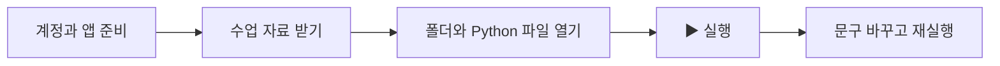
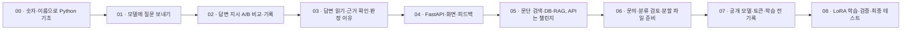

# kt cloud 생성형 AI 과정

[기본·복습·나중에 다시 풀 챌린지](CHALLENGES.md)

[온라인 실습 안내 · 화면·실행·질문·재접속](ONLINE-CLASS.md)

**첫날에는 [아주 쉬운 OT 요약](course-orientation-simple.md)부터 읽습니다.** 무엇을 만들고, 어떤 도구를 쓰고, 어떻게 연습하는지 쉬운 말로 안내합니다.

[자세한 과정 오리엔테이션](course-orientation.md)은 8개 교과의 내용·도구·모델·결과물을 그림과 표로 설명합니다. 필요한 내용을 더 확인할 때 참고합니다.

**처음이라면 [설치와 첫 실행](setup/README.md)를 번호순으로 따라오세요.** GitHub 계정, VS Code, Python을 준비한 뒤 자료를 ZIP으로 받아 압축을 풀고 VS Code로 엽니다. 파일을 열어 ▶로 인사말을 실행하고 문구를 바꿔 봅니다.



## 00 운영 · 하루 8시간씩 2일

| 일차 | 진행할 내용 | 남길 결과 |
|---|---|---|
| 1일차 · 8시간 | OT, 계정과 앱 준비, ZIP 받기, 첫 실행, 변수·입력·조건문, 관련 랩 | 직접 만든 Python 파일과 입력별 실행 결과 |
| 2일차 · 8시간 | 숫자 합계·반복문·이름과 점수 딕셔너리·함수, GitHub 업로드. 파일·JSON·종합 앱은 선택 | 숫자 계산·점수 처리 프로그램과 내 GitHub의 실습 파일 |

00은 기본 Python으로 실행합니다. 가상환경 생성과 외부 라이브러리 설치는 01의 실제 모델 연결 준비에서 진행합니다. 설치에 걸리는 시간과 학생별 진도에 따라 랩 일부는 복습으로 이어갈 수 있습니다.

## 이 교재를 쓰는 방법

첫날에는 **안내를 읽기 → 예제를 그대로 실행하기 → 작은 부분을 바꿔 보기 → 달라진 결과를 확인하기** 순서로 진행합니다. 이후에는 같은 방식으로 가상의 고객 상담 서비스를 발전시킵니다. 01부터는 요금 문의에 모델 답변을 만들고, 후속 교과에서는 응답을 평가하고 고객 안내 문서 검색을 붙입니다.

| 처음 보는 용어 | 수업에서 하는 일 |
|---|---|
| Python | 문의를 읽고, 모델에 보낼 문장을 만들고, 답변을 출력하는 코드를 실행합니다. |
| VS Code | 폴더를 열어 코드와 README를 읽고, 실행 버튼으로 코드를 실행하고 아래쪽에서 결과를 확인합니다. |
| GitHub | 수업 자료를 ZIP으로 받고, 실습한 파일을 내 저장소에 업로드합니다. |
| Codex · GitHub Copilot | 00~03은 직접 코딩하고, 04~08도 직접 시도·수정·실행합니다. 필요하면 Copilot을 참고하고 07부터 Codex도 선택할 수 있습니다. 04·07 교과의 AI 도구 안내를 참고합니다. |

### 수업 시간에 열어 둘 것

- 브라우저에서 **오늘 교과의 README**를 열어 설명과 그림을 봅니다.
- VS Code에서는 **같은 교과의 압축을 푼 수업 폴더**를 열고, 실습 파일과 터미널을 나란히 확인합니다.
- 오늘의 활동을 마치면 정상 출력이나 관찰 결과를 한 줄씩 기록합니다. 질문할 때는 **교과·활동 이름, 누른 실행 버튼 또는 명령, 오류 마지막 3~5줄**을 보내면 선생님이 같은 위치를 확인할 수 있습니다.

## 공통 가이드 폴더

`00` 저장소는 아래처럼 구성됩니다.

```text
ktai-00-course-guide/
├── README.md          # 과정 전체 안내
├── course-orientation-simple.md  # 첫날 함께 읽는 쉬운 OT
├── course-orientation.md  # 필요할 때 읽는 교과·도구·로드맵 상세 참고
├── setup/             # 계정과 앱 설치, ZIP 자료 받기, 첫 실행 안내
├── python-basics/     # 번호순 단원과 종합 랩
├── troubleshooting/  # 설치·실행 문제 해결
└── assets/images/     # 교재 그림
```

## 강의 순서

| 강의 순서 | 교과 | 저장소 |
|---:|---|---|
| 1 | 생성형 AI 개요 & LLM | `ktai-01-llm-basics` |
| 2 | 프롬프트 엔지니어링 | `ktai-02-prompt-engineering` |
| 3 | LLM 성능 평가 | `ktai-03-llm-evaluation` |
| 4 | 생성형AI 응용 애플리케이션 개발 | `ktai-04-genai-app` |
| 5 | 최신 생성형 AI 기술 · RAG | `ktai-05-rag-and-llm-techniques` |
| 6 | LLM 데이터 준비 및 전처리 | `ktai-06-llm-data-prep` |
| 7 | 오픈소스 LLM 활용 · Hugging Face | `ktai-07-open-source-llm` |
| 8 | 파인튜닝 | `ktai-08-fine-tuning` |

교과 자료는 선생님이 수업 채널에 공유한 해당 저장소 주소에서 받습니다. 수업 중에는 설명과 랩을 번갈아 진행합니다. 수업 후에는 쉬운 워크숍과 짧은 과제로 복습하고, 챌린지는 수업 중 선택 확장이나 이후 재도전에 사용합니다.

설치나 실행이 막히면 [문제 해결](troubleshooting/README.md)을 확인하세요.

## 공식 참고 자료

- [Python 한국어 튜토리얼](https://docs.python.org/ko/3/tutorial/) · 첫 실행 이후 기초 문법을 복습합니다.
- [VS Code의 Python 시작 안내](https://code.visualstudio.com/docs/python/python-tutorial) · 확장 설치와 인터프리터 선택 화면을 확인합니다.
- AI 코딩 도구는 04부터 필요하면 Copilot을 활용하고, 07부터 Codex 앱도 선택할 수 있습니다. 사용법은 각 교과의 ai-coding 폴더에서 확인합니다.

## 00을 진행하며 확인할 결과

설치가 처음이라면 수업에서 함께 준비해도 됩니다. 00을 진행하면서 아래 결과를 하나씩 확인합니다. 처음 참여하기 전에 모두 끝내야 하는 과제는 아닙니다.

| 준비 결과 | 확인하는 곳 |
|---|---|
| 수업용 GitHub 계정으로 로그인했습니다. | [계정 준비](setup/00-github-account.md)에서 사용자 이름을 확인합니다. |
| 수업 저장소를 로컬 폴더로 받았습니다. | [자료 받기](setup/04-git-github.md)에서 VS Code 왼쪽의 `README.md`와 `python-basics`를 확인합니다. |
| Python을 실행하고 결과를 바꿔 봤습니다. | [첫 실행](python-basics/01-run-and-print/README.md)에서 인사말을 직접 바꾸고 다시 실행합니다. |
| 내 GitHub에서 수정한 파일을 확인했습니다. | [내 파일 업로드](setup/04-git-github.md#6-완성한-파일-올리기)를 진행하고 브라우저에서 새 문구를 확인합니다. |

처음에는 파일 실행 → 변수·입력 → 조건문 순서로 한 가지씩 익힙니다. 반복문과 딕셔너리는 그다음에 예제와 함께 읽습니다. [Python 기초 목차](python-basics/README.md)에서 현재 익힐 단원과 복습할 랩을 찾을 수 있습니다.

## 00부터 08까지 이어가기



| 교과 | 컴퓨터에서 열 폴더 | 준비 환경 | 다음에 이어 쓸 경험·선택 자료 |
|---|---|---|---|
| 00 | ktai-00-course-guide | 기본 Python, API 키·외부 Python 패키지 없음 | 변수·조건·반복·딕셔너리·함수의 기초, 파일·JSON은 선택 관찰 |
| 01 | ktai-01-llm-basics | 01의 .venv와 .env, 처음에 전체 라이브러리 설치 | 질문·답변 지시 구분, 사용 가능한 키·모델, Docker의 로컬 모델 |
| 02 | ktai-02-prompt-engineering | 02의 .venv와 .env, 처음에 전체 설치 | 지시 비교 경험, 기록 파일 전달은 선택 |
| 03 | ktai-03-llm-evaluation | 03의 .venv와 .env, 처음에 전체 설치 | 판정 이유·실패 사례, 파일 보고서는 선택 |
| 04 | ktai-04-genai-app | 04의 .venv와 .env, FastAPI·Uvicorn 포함 처음에 전체 설치 | 입력 폼·Swagger UI·모델 응답·피드백 |
| 05 | ktai-05-rag-and-llm-techniques | 05의 .venv·.env, Part 02 전 PostgreSQL·pgvector·BGE-M3 준비 | 문단 검색·DB 조회·근거 대조, FastAPI는 선택 챌린지 |
| 06 | ktai-06-llm-data-prep | 06의 .venv·.env, DB·임베딩은 필요 없음 | 문의·분류 검토, 묶음 단위 분할, 07·08 전달 파일 |
| 07 | ktai-07-open-source-llm | 07의 .venv, Transformers·PyTorch·Qwen 파일, 기본 API 키 불필요 | 실제 토큰·한두 문의·학습 전 기준 기록 |
| 08 | ktai-08-fine-tuning | 08의 .venv, PyTorch·Transformers·PEFT, 기본 API 키 불필요 | 같은 자료·모델의 LoRA 학습·검증·최종 테스트 |

자료는 교과마다 선생님 저장소에서 ZIP으로 받고, Windows는 C:/ktai 아래에 각 폴더를 나란히 둡니다. macOS는 사용자 홈의 ktai 아래에 같은 이름으로 둡니다. 같은 가상환경을 계속 쓰는 범위는 **해당 교과 전체**입니다. 교과가 바뀌면 그 폴더에 새 .venv를 만들며, 날짜가 바뀔 때마다 다시 만드는 것은 아닙니다. 04의 Part 00 준비 단원도 04의 같은 환경을 씁니다. 00 Python 기초에서는 가상환경을 만들지 않습니다.

API 키는 같은 계정의 값을 사용할 수 있지만 각 교과의 .env에 따로 저장합니다. Docker Desktop·ktai-ollama·받은 모델은 다시 설치하지 않고 재사용합니다. 00에서 만든 Python 파일을 01 폴더로 옮겨야만 시작할 수 있는 것은 아닙니다. 다음 교과의 README와 SETUP부터 진행합니다.

02의 JSONL 기록은 03의 선택 기록 읽기 실습을 할 때만 복사합니다. 파일 전달 방법은 02 마지막 안내와 03의 기록 읽기 랩에 있습니다. 03에서 만든 평가 보고서를 04에 복사해야 앱이 실행되는 구조는 아닙니다. 04에서는 03의 평가 기준을 답변 검토에 적용하고 새 피드백을 따로 저장합니다. 선택 종합 앱·워크숍을 모두 끝내지 않아도 다음 교과로 진행할 수 있습니다.

## 00을 마치고 01로 넘어갈 때

00에서는 숫자·이름·점수로 변수·입력·조건·반복·함수를 연습했습니다. 01에서는 같은 문법으로 모델에 보낼 질문을 만들고 답변을 받습니다. **파일·JSON·종합 앱·선택 워크숍을 모두 마칠 필요는 없습니다.**

1. 00 폴더와 직접 고친 파일은 그대로 보관합니다.
2. 선생님의 `ktai-01-llm-basics` 저장소에서 ZIP을 받아 압축을 풉니다. 00 안에 넣거나 00에 덮어쓰지 않습니다.
3. Windows는 `C:\ktai\ktai-01-llm-basics`, macOS는 내 사용자 폴더의 `ktai/ktai-01-llm-basics`를 VS Code에서 새로 엽니다.
4. 01의 README와 `part-01/01-get-ready/README.md`에서 짧은 복습 후 환경을 준비합니다.

00에서 준비한 Python·VS Code·GitHub 계정은 그대로 사용합니다. **01에서 처음 만드는 것은 01의 .venv와 .env**입니다. 라이브러리는 01에서 처음 한 번 설치하고 Part 02·03에는 같은 환경을 사용합니다. Docker Desktop은 Part 03에서 준비합니다. 00에서 미리 설치하거나 API 키를 발급받을 필요는 없습니다.

## 04를 마치고 05로 넘어갈 때

04의 유형별 고정 자료를 05에서는 질문에 맞는 문단 검색으로 바꿉니다. 05 기본 실습은 최상위 환경에서 진행하고, 04의 API·Swagger·화면을 접목하는 활동은 05 챌린지입니다. 두 번째 extra-fastapi 환경은 선택 시점에만 준비합니다. 04의 피드백 파일·보고서·화면 코드를 05에 복사하지 않습니다.

## 05를 마치고 06으로 넘어갈 때

05는 검색할 안내 문서, 06은 문의와 사람이 붙인 분류를 다룹니다. 05 DB·API 챌린지 완료와 관계없이 06의 자체 가상 데이터로 시작할 수 있습니다. 06은 문의 한 건과 작은 수정부터 배우고 준비된 함수로 분할·저장을 확인합니다. 새 DB·임베딩은 필요하지 않습니다. 최종 분할 파일은 07·08에서 사용하지만 06에서 모델을 학습한 것은 아닙니다.

## 07을 마치고 08로 넘어갈 때

08은 06의 같은 train·validation·test 세 파일과 07의 같은 Qwen·분류 지시·생성 조건을 사용합니다. 07의 기준 기록은 참고이며 08은 어댑터 OFF/ON으로 전후를 다시 비교합니다. 기본 학습은 준비 함수로 진행하고 작은 분류기·마스킹·자동 집계는 챌린지입니다. 08의 새 .venv를 준비하지만 기본에 API 키·DB·웹 서버는 필요하지 않습니다. 추론 성공이 학습 메모리까지 보장하지는 않습니다.
