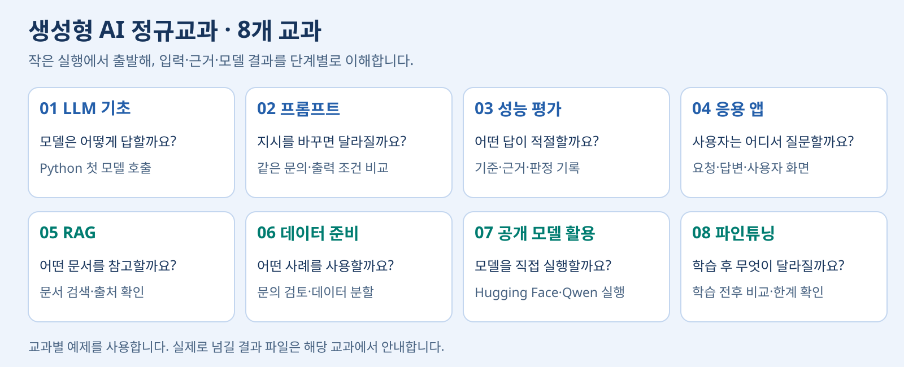
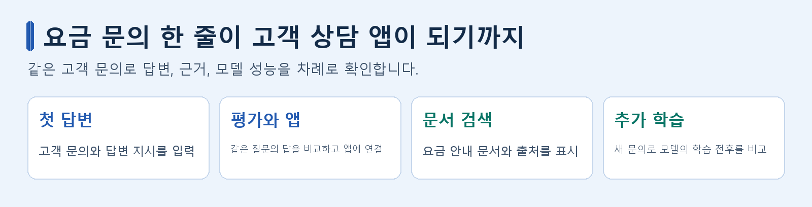
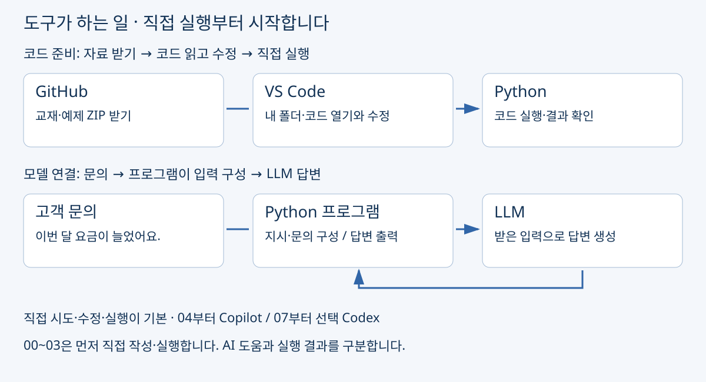
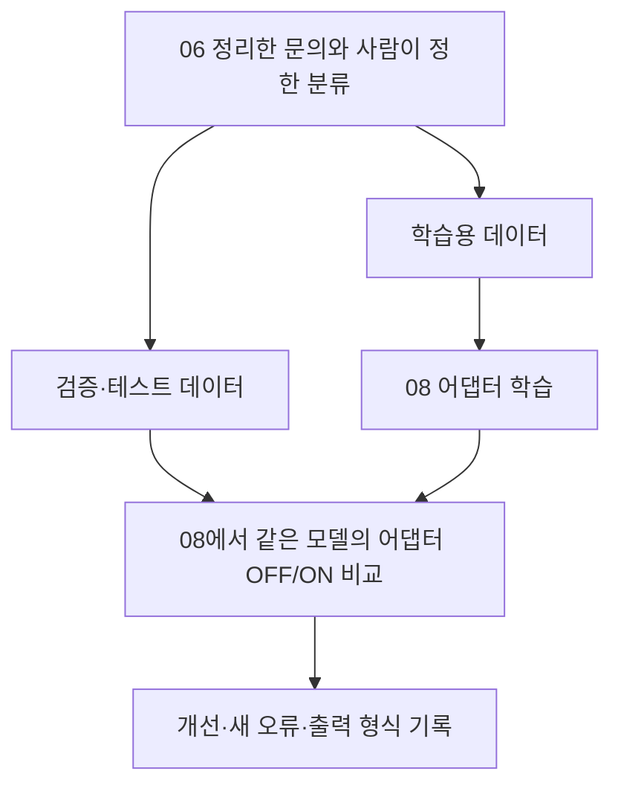
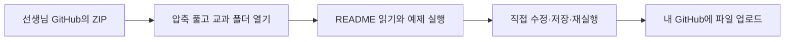

# 전체 과정 안내 · 교과·도구·학습 흐름 상세편

[첫날 OT 요약편](course-orientation-simple.md) · [공통 가이드](README.md) · [설치와 첫 실행](setup/README.md) · [Python 기초](python-basics/README.md)

이 문서는 **필요할 때 찾아 읽는 상세 참고편**입니다. 첫날에는 요약편으로 과정의 목적과 시작 방법을 보고, 교과·도구·파일 연결이 궁금할 때 아래 항목을 확인합니다. 상세편 전체를 먼저 읽어야 실습을 시작하는 것은 아닙니다.

이 과정에서는 **사용자의 질문을 받고, 답변을 만들고, 결과를 검증할 수 있는 생성형 AI 서비스**를 단계별로 만듭니다. 수업에서는 가상의 고객 상담 서비스를 공통 예제로 사용합니다.

> 이번 달 요금이 지난달보다 많이 나왔어요. 지금 무엇부터 확인해야 하나요?

00에서는 파일을 열고 인사말을 출력하는 것부터 연습합니다. 01 정규교과에서는 위 문의를 Python에서 읽고 모델에 보내는 입력을 만듭니다. 이후 답변이 요금 안내 문서에 근거하는지 확인하고, 여러 모델의 결과를 같은 기준으로 비교합니다. 설치가 처음이라면 [설치와 첫 실행](setup/README.md)부터 함께 준비합니다. Python 예제가 실행되는 상태라면 [첫 파일 만들기](python-basics/labs/00-first-run/README.md)로 이어갑니다.

## 처음에는 이것부터 생각해 봅시다

프로그래밍 경험이 없어도 00에서 파일 열기와 실행부터 배웁니다. 오늘은 아래 8개 교과의 용어를 모두 외우거나 모델 설치를 끝내는 날이 아닙니다. **작은 코드를 실행하고, 한 줄을 바꾸고, 결과가 달라지는 경험**부터 시작합니다.

예제의 ‘고객 문의’는 요금뿐 아니라 계정·배송·서비스 불편도 포함합니다. 수업 자료는 가상 사례이며 실제 고객의 청구서나 개인정보를 가져올 필요는 없습니다. 같은 문의를 여러 교과에서 다시 쓰는 이유는 새 도구가 어떤 역할을 더하는지 비교하기 위해서입니다.

| 단계 | 처음 확인할 결과 |
|---|---|
| 00 · 준비와 Python 기초 | 인사말을 바꾸고 ▶로 새 문장을 출력합니다. |
| 01~03 · 모델 호출과 비교 | 문의를 보내 답변을 받고, 지시를 바꾸고, 근거로 평가합니다. |
| 04~06 · 앱·검색·데이터 | 요청을 받고 문서를 찾으며, 사용할 사례를 정리합니다. |
| 07~08 · 공개 모델과 학습 | 같은 입력의 기준 결과를 남기고 학습 전후를 비교합니다. |

### 처음 등장하는 용어

| 용어 | 이 수업에서 뜻하는 것 |
|---|---|
| 생성형 AI | 입력한 내용과 조건에 따라 글·이미지 등의 결과를 만드는 AI입니다. 이 과정은 주로 텍스트를 다룹니다. |
| LLM | 많은 텍스트로 학습한 언어 모델입니다. 문의를 읽고 안내 문장을 생성하는 데 사용합니다. |
| 프롬프트 | 모델에 전달하는 입력입니다. 지시, 고객 문의, 참고 문서를 함께 넣을 수 있습니다. |
| API | 프로그램이 다른 프로그램의 기능을 요청하고 결과를 받는 연결 방식입니다. |
| 로컬 | 지금 사용하는 내 컴퓨터를 뜻합니다. |
| 저장소 | GitHub에서 코드와 문서를 모아 두는 공간입니다. |

## 궁금한 내용 찾아보기

| 궁금한 것 | 읽을 곳 |
|---|---|
| 전체 과정에서 무엇을 배우나요? | [과정의 위치](#1-전체-과정에서-지금-어디에-있나요), [8개 정규교과](#2-같은-요금-문의로-무엇을-배우나요) |
| 수업 자료와 실습은 어떻게 사용하나요? | [참여 방법](#3-수업에는-어떻게-참여하나요), [자료 받기와 결과 남기기](#6-수업-자료를-받고-내-결과를-남기는-방법) |
| 프로그래밍이 처음인데 어디부터 하나요? | [Python 기초의 시작](#4-프로그래밍이-처음이라면-무엇부터-하나요) |
| 교과 사이의 자세한 연결이 궁금해요. | [교과별 발전 흐름](#5-교과가-바뀔-때-예제는-어떻게-발전하나요) · 뒤 교과에서 다시 읽어도 됩니다. |
| 온라인 실습 중 막혔어요. | [질문과 복습](#7-온라인-수업에서-막혔을-때와-복습할-때) |

OT에서 먼저 볼 것은 과정의 목적과 시작 방법입니다. 뒤 교과의 설치 이름과 전문 용어는 해당 수업에서 다시 설명합니다.

## 1. 전체 과정에서 지금 어디에 있나요?

| 단계 | 공부하는 내용 | 남기는 결과물 |
|---|---|---|
| 수업 준비 | GitHub 계정, ZIP 자료 받기, VS Code와 Python 실행 | 내 컴퓨터의 첫 Python 예제와 내 GitHub에 올린 실습 파일 |
| 정규교과 | LLM, 프롬프트, 평가, 앱, RAG, 데이터 준비, 오픈소스 모델, 파인튜닝 | 첫 모델 호출부터 학습 전후 비교까지 교과별 실습 결과 |
| 현업 이해와 취업 준비 | 클라우드 특강, 협업, 제품 개발, 포트폴리오와 면접 준비 | 프로젝트와 구현 경험을 설명할 수 있는 자료 |
| 기본·심화·실무 통합 프로젝트 | 모델과 앱을 연결하고, 팀으로 검증·배포·운영을 경험 | 실행 가능한 서비스, 평가 기록, 발표 자료 |

**아래에서 소개하는 정규교과 8개는 총 150시간**입니다. 그림과 표는 실제 수업 순서대로 배치했습니다. 시간표는 편성 기준이며 Part는 날짜가 아닌 학습 묶음입니다. 실제 진행 속도에 따라 04에서 복습·직접 코딩·선택 챌린지를 충분히 진행할 수 있습니다. 자세한 운영 순서는 각 교과 README를 따릅니다.

150시간은 아래 01~08 정규교과의 합계입니다. **00은 OT·설치·첫 실행·Python 기초를 합쳐 하루 8시간씩 이틀로 운영하는 준비 자료**입니다. OT 설명만 이틀 동안 진행한다는 뜻은 아닙니다. 후속 프로젝트와 상세 일정은 선생님이 공유한 전체 시간표에서 확인합니다.



교과 그림은 배우는 경험의 연결을 보여 줍니다. 모든 결과 파일이 자동으로 다음 교과에 전달되는 것은 아닙니다. 02→03 실행 기록 전달은 선택 활동입니다. 06→07·08 분할 데이터 전달은 해당 교과 안내를 따릅니다.

## 2. 같은 요금 문의로 무엇을 배우나요?

| 실제 순서 | 편성 시간 | 배울 내용 | 실습에서 만들어 볼 것 |
|---:|---|---|---|
| 1 | **22시간** | **생성형 AI 개요 & LLM.** LLM의 발전 흐름과 BERT·GPT의 대표 용도를 짧게 보고, 문장을 토큰으로 나누는 방식과 모델 호출 흐름을 확인합니다. | 요금 문의를 프롬프트로 만들어 데모와 모델 API 응답을 비교하는 Python 예제 |
| 2 | **22시간** | **프롬프트 엔지니어링.** 모델에게 맡길 일, 참고할 정보, 출력 형식을 써 봅니다. 예시를 입력에 주는 few-shot도 실습합니다. | 같은 문의에 대해 첫 확인 단계를 제시하는 프롬프트와 추가 질문 두 개를 만드는 프롬프트 |
| 3 | **22시간** | **LLM 성능 평가.** 같은 질문의 답변을 자료와 대조하고, 사람의 판정과 간단한 일치율을 구분합니다. 여러 사례·자동 지표는 선택 참고로 살펴봅니다. | 요금·계정·배송 문의가 들어 있는 평가셋과 근거·형식·정확도를 확인하는 채점표 |
| 4 | **14시간** | **생성형 AI 응용 앱.** 모델 호출을 사용자 화면 또는 API에 연결합니다. 응답 오류와 사용자 피드백도 다룹니다. | 문의를 받고 답변을 표시하는 작은 고객 상담 앱 |
| 5 | **14시간** | **RAG와 최신 기술.** 질문과 관련 있는 문서를 검색해 모델 입력에 넣습니다. 문단을 저장하고 다시 읽거나, 검색 결과가 없을 때의 응답도 확인합니다. | 가상의 요금 안내 문서를 검색하고 답변과 함께 참조 문서를 보여 주는 기능 |
| 6 | **12시간** | **LLM 데이터 준비.** 예제 데이터를 읽고 빈 값·중복·분류 문제를 검토합니다. 학습·검증·테스트에 어떤 데이터를 쓸지 구분합니다. | 문의 본문·분류가 담긴 JSONL과 학습·검증·테스트 분할 파일 |
| 7 | **22시간** | **오픈소스 LLM 활용.** Hugging Face에서 모델 카드와 라이선스, 토크나이저, 실행 조건을 읽고 모델을 호출합니다. | 사전학습 모델을 실행해 같은 문의에 대한 기준 답변을 기록한 결과 |
| 8 | **22시간** | **파인튜닝.** 준비한 예제로 모델을 추가 학습시키고, 학습에 사용하지 않은 문의로 전후 성능을 비교합니다. | Qwen의 LoRA 어댑터와 같은 문의에 대한 학습 전후 비교 결과 |



### 도구가 하는 일을 구분해 봅시다

아래 그림은 자료를 받는 도구, 코드를 편집하는 도구, 실행하는 프로그램과 답변을 만드는 모델의 역할을 구분합니다. 00~03은 직접 코딩하고, 04~08은 직접 시도하면서 필요하면 Copilot의 설명·힌트를 참고합니다. Codex는 07부터 선택적으로 활용합니다.



### 사용하는 프로그램과 서비스

처음부터 모두 설치하지 않습니다. **00에서는 계정·편집기·Python과 첫 실행을 준비**하고, 나머지는 사용하는 교과에서 안내합니다.

| 이름 | 어떤 역할인가요? | 처음 사용하는 시점 | 준비 방식 |
|---|---|---|---|
| **GitHub** | 선생님 자료를 ZIP으로 받고, 내 실습 파일을 저장·공유하는 웹 서비스 | 00 | 계정을 만들고 브라우저에서 사용 |
| **VS Code** | 코드와 README를 열고 수정·실행하는 편집기 | 00 | 프로그램과 Microsoft Python 확장 설치 |
| **Python 3.12.10** | 작성한 코드를 실제로 실행하는 프로그램 | 00 | 설치 후 ▶로 실행. 가상환경은 01부터 준비 |
| **PowerShell / Terminal** | 설치·서버 실행 등의 명령을 입력하고 결과를 보는 창 | 00 선택 연습, 01 환경 준비부터 활용 | Windows는 PowerShell, macOS는 Terminal 사용 |
| **Docker Desktop** | 로컬 모델·DB를 실행할 컨테이너를 관리하는 프로그램 | 01 Part 03 | 해당 단원에서 설치. 이후 교과에서 재사용 |
| **Ollama** | Qwen·KT 모델을 내려받고 실행해 Python 요청에 답하는 프로그램 | 01 Part 03 | 수업에서는 Docker 컨테이너로 실행 |
| **Hugging Face Hub** | 공개 모델의 설명·라이선스·파일을 찾는 웹 서비스 | 07에서 본격적으로 학습 | 브라우저로 확인하고 코드로 모델 파일 다운로드 |
| **GitHub Copilot** | 코드 설명·오류 원인·짧은 힌트를 받는 AI 코딩 도구 | 04부터 **선택** | 이용 가능한 경우 VS Code에서 사용 |
| **Codex 앱** | 작은 범위의 코드 설명·수정·검토를 돕는 AI 코딩 도구 | 07부터 **선택** | 이용 가능한 경우 설치·로그인. 기본 실습의 필수 조건 아님 |

Ollama는 모델 이름이 아니라 **모델을 실행하는 도구**입니다. Hugging Face Hub는 모델을 찾고 내려받는 곳입니다. GitHub에 로그인하는 것, 모델 API 키를 준비하는 것, AI 코딩 도구에 로그인하는 것은 서로 다른 준비입니다.

### 사용하는 LLM과 검색용 모델

| 모델 | 수업에서 하는 일 | 사용하는 방식 | 주요 교과 |
|---|---|---|---|
| **OpenAI · GPT-4.1 mini** | 고객 문의에 답하고 프롬프트·평가 결과 비교 | 제공사 API 호출. `.env`에 `gpt-4.1-mini` 설정 | 01~06, 07 선택 비교 |
| **Google · Gemini 2.5 Flash-Lite** | 같은 입력을 다른 제공사에 보내 결과 비교 | 제공사 API 호출. `.env`에 `gemini-2.5-flash-lite` 설정 | 01~06, 07 선택 비교 |
| **Qwen 2.5 0.5B Instruct** | 작은 로컬 모델 실행, 분류 결과 기록, 추가 학습 | Ollama: `qwen2.5:0.5b` / 직접 실행: `Qwen/Qwen2.5-0.5B-Instruct` | 01~07 활용, 08 학습 |
| **KT · 믿:음 2.0 Mini Instruct** | Qwen과 같은 문의의 답변 비교 | Ollama: `hf.co/mykor/Midm-2.0-Mini-Instruct-gguf:Q4_K_M` | 01~06, 07 선택 비교 |
| **BGE-M3 · 임베딩 모델** | 문서와 질문을 검색용 숫자 목록으로 변환 | 로컬 Ollama에서 실행. 고객 답변을 쓰는 LLM과 역할이 다름 | 05 RAG |

로컬 생성 LLM은 **Qwen·KT 두 가지**로 진행합니다. 작은 Qwen으로 먼저 연결하고 필요한 경우 KT와 비교합니다. 같은 Qwen 계열이어도 Ollama 파일과 Transformers 파일은 형식·실행 도구가 달라 서로 바꿔 넣지 않습니다.

클라우드 API는 계정의 요금·무료 사용 범위를 확인합니다. Gemini 무료 이용도 계정·모델·한도 확인이 필요합니다. 07~08 기본 경로는 Hugging Face에서 공개 Qwen 파일을 내려받아 내 PC에서 실행·학습하며, 유료 추론 서버를 신청하는 과정은 없습니다. PC 메모리·저장 공간·실행 시간은 필요합니다.

### 코드 안에서 사용하는 주요 라이브러리와 DB

라이브러리는 Python 코드가 불러 쓰는 기능입니다. 프로그램을 하나씩 별도로 설치하듯 준비하지 않고 **해당 교과의 requirements.txt로 함께 설치**합니다. PostgreSQL과 pgvector는 05의 DB 안내를 따릅니다.

| 이름 | 역할 | 처음 사용하는 시점 |
|---|---|---|
| **OpenAI SDK · google-genai · python-dotenv** | API 요청과 `.env` 설정 읽기 | 01에서 함께 설치 |
| **FastAPI · Uvicorn** | Python 함수를 웹 API로 제공하고 서버 실행 | 04 |
| **Swagger UI** | 브라우저에서 API 요청을 시험하는 화면 | 04. FastAPI의 `/docs`에서 사용하며 별도 앱 설치 없음 |
| **PostgreSQL · pgvector** | 문단·벡터를 저장하고 가까운 자료 검색 | 05. DB 컨테이너와 벡터 확장 준비 |
| **Transformers · PyTorch** | 토크나이저·모델을 Python에서 직접 불러와 계산 | 07 |
| **PEFT · LoRA** | 추가 가중치를 학습해 모델 동작을 조정 | 08. PEFT는 라이브러리, LoRA는 학습 방법 |

기본 흐름은 **직접 시도 → 필요하면 설명·힌트 참고 → 학생이 수정 → 재실행·결과 확인**입니다. Copilot·Codex를 이용하지 못해도 교안·풀이·선생님 안내로 진행합니다.

## 3. 수업에는 어떻게 참여하나요?

| 구간 | 코딩을 연습하는 방법 |
|---|---|
| 00~03 | 예제 읽기 → 직접 입력·수정 → 실행 → 오류와 결과 확인 |
| 04~06 | 직접 시도 → 필요하면 Copilot에 설명·힌트 요청 → 학생이 수정 → 재실행 |
| 07~08 | 직접 시도 → 필요하면 Copilot에 설명·힌트 요청 → 학생이 수정 → 재실행·평가 |

07~08에서도 먼저 직접 시도하고 학생이 코드를 수정·실행합니다. Codex는 계정·설치·사용량 조건이 맞을 때만 선택하며, 사용하지 않아도 수업과 과제에 참여할 수 있습니다. Copilot도 사용할 수 없으면 교안의 힌트·풀이와 선생님 안내로 진행합니다.

Copilot은 무료 사용량에 한도가 있습니다. 한도를 소진하면 해당 기능이 제한되고, 계속 이용하기 위해 유료 플랜을 선택하면 비용이 발생합니다. 무료 한도 소진만으로 유료 구독이 자동 시작되지는 않습니다. 갱신을 기다리는 동안에는 교안과 직접 코딩으로 실습을 이어갑니다. 자세한 안내는 04 교과의 ai-coding/github-copilot-vscode.md에서 확인합니다.


| 활동 | 학생이 하는 일 |
|---|---|
| 선생님과 랩 | 같은 파일을 열고 기준 출력을 확인합니다. 실행한 파일과 바뀐 한 줄을 기록합니다. |
| 쉬운 워크숍 | 수업 후 질문·문구·숫자 한 곳을 바꾸어 복습합니다. 먼저 해 본 뒤 답안과 비교합니다. |
| 선택 챌린지 | 수업 중 여유 시간이나 관련 내용을 배운 뒤 선택합니다. 함수·반복·파일·JSON·집계 등 추가 응용을 다시 연습합니다. |
| 기본 과제 | 배운 예제의 작은 수정이나 판단 이유를 정리합니다. 복합 조건·파일·JSON·자동 보고서는 선택 범위를 구분합니다. 먼저 시도한 뒤 답안과 비교하며 제출 방법은 선생님 안내를 따릅니다. |

실행 오류가 생겼을 때는 **교과·랩, 컴퓨터 종류, 실행한 파일, 누른 버튼 또는 명령, 오류 마지막 3~5줄**을 함께 확인합니다. API 계정 준비 중인 학생은 데모 코드로 첫 모델 호출의 입력과 출력을 살펴볼 수 있습니다.

데모는 미리 준비된 답변이나 설명용 값을 사용해 코드 흐름을 연습하는 방식입니다. 실제 모델 실행은 입력을 보내 새 응답을 받는 방식입니다. 결과를 기록할 때 사용한 모드도 함께 적습니다. API 실습에 사용하는 계정과 키는 해당 교과의 안내에 따라 준비하며, 호출 전에 사용량과 비용을 확인합니다.


### 설치와 비용은 필요한 교과에서 확인합니다

00에서는 GitHub 계정·VS Code·Python과 수업 자료를 준비합니다. 가상환경과 API 키는 01, Docker Desktop은 로컬 모델을 사용하는 단계, DB는 05, Codex 앱은 07 안내에 따라 준비합니다. 처음부터 모두 설치하지 않습니다.

현재 OpenAI 수업 예시는 `gpt-4.1-mini`이며, 공식 안내의 종료 예정일은 **2027-01-14**입니다. API 모델은 지원이 끝날 수 있어 01을 시작할 때 사용할 이름과 일정을 다시 확인합니다. 00에서 키를 만들거나 호출할 필요는 없습니다. [공식 종료 일정](https://developers.openai.com/api/docs/deprecations)

API 호출은 ChatGPT 같은 채팅 서비스의 구독과 별개입니다. 사용할 계정의 결제·무료 사용 범위·한도를 해당 교과에서 확인합니다. Gemini 무료 사용도 모든 계정·모델에 무제한으로 제공되는 것은 아닙니다. 로컬 모델은 외부 생성 API 대신 내 컴퓨터의 메모리·저장 공간·실행 시간이 필요합니다. 다운로드가 오래 걸리면 중복 실행하지 말고 현재 상태를 확인합니다.

실습에서 막히거나 수업 연결이 끊겼을 때는 [온라인 실습 안내](ONLINE-CLASS.md)에서 현재 화면과 이어갈 위치를 확인할 수 있습니다. 모든 학생이 같은 속도로 설치·모델 실행을 끝내야 다음 설명을 들을 수 있는 것은 아닙니다.

## 4. 프로그래밍이 처음이라면 무엇부터 하나요?

00의 Python 기초는 숫자·이름·점수처럼 익숙한 자료로 배웁니다. 한 번에 한 가지 문법을 익히고, 고객 문의는 기초 뒤의 선택 응용으로 연결합니다.

| 처음 배울 것 | 수업에서 해 보는 일 |
|---|---|
| 출력 | 인사말과 계산 결과를 화면에 보여 줍니다. |
| 변수와 계산 | 두 수의 합과 물건의 총액을 구합니다. |
| 입력 | 이름이나 정수를 입력받습니다. |
| 조건문 | 양수·0·음수, 짝수·홀수를 구분합니다. |
| 리스트와 반복문 | 숫자 목록을 읽고 1부터 10까지 더합니다. |
| 딕셔너리 | 이름·나이·점수를 키로 찾습니다. |
| 함수 | 두 수의 합과 평균 계산을 다시 사용합니다. |
| 선택 파일·JSON | 짧은 글자를 저장·읽고 자료 형식을 관찰합니다. |

[Python 기초 목차](python-basics/README.md)에서 설명 → 작은 예제 → 연결 랩 → 풀이 순서로 진행합니다. 시작 코드의 TODO는 고칠 위치를 알려 주는 주석입니다. 문의 분류·메뉴·종합 앱을 처음부터 함께 구현하지 않습니다.

## 5. 교과가 바뀔 때 예제는 어떻게 발전하나요?

### 01~03 · 답변을 만들고 비교하기

01에서는 고객 문의와 모델에게 줄 지시를 한 입력으로 만듭니다. 예를 들어 “이번 달 요금이 올랐어요”에 “먼저 확인할 항목 한 가지를 안내하세요”라는 지시를 붙입니다. 01의 가상환경과 .env를 준비한 뒤 OpenAI로 실제 첫 답변을 받습니다. 이어 Gemini와 로컬 모델로 연결을 넓힙니다. 계정이나 연결이 막혔을 때는 저장된 데모로 입력·출력 흐름을 살펴보고 실제 호출과 구분합니다.

02에서는 같은 문의를 유지한 채 지시와 출력 형식을 바꿉니다. “확인할 항목 한 가지”와 “추가 질문 두 개”를 각각 요청하고 어떤 답변이 나오는지 기록합니다. JSON으로 결과를 요청했다면 이름과 값을 눈으로 관찰합니다. Python으로 읽고 항목을 검사하는 활동은 이후 다시 풀 수 있는 선택 챌린지입니다.

03에서는 화면의 답변 한 건을 읽어 기준을 정합니다. 02의 기록 파일 읽기와 보고서 저장은 선택 활동이며 기본 진행 조건이 아닙니다. 가상 청구서에 지난달 32,000원, 이번 달 35,000원만 적혀 있다면 차액은 계산할 수 있습니다. 증가 원인을 설명하려면 항목별 내역이 더 필요합니다. 학생은 금액의 정확성, 답변의 근거, 요청한 출력 형식을 각각 확인합니다.

### 04~05 · 사용자가 쓸 수 있는 앱과 문서 검색

04에서는 짧은 Python 랩으로 질문·공백·자료·답변을 복습한 뒤 문의 입력과 답변 출력을 브라우저 화면에 연결합니다. 공백 문의 안내와 도움 여부를 작은 코드로 연습합니다. 완성 앱의 저장 기능은 준비 코드를 사용하고, 파일 집계·API 확장은 선택 챌린지로 진행합니다. FastAPI 기초 예제에서는 주소로 요청을 보내고 Python 함수의 결과를 JSON으로 받는 과정을 연습합니다. /docs의 Swagger UI에서 요청을 직접 시험한 뒤 같은 기능을 고객용 화면에 연결합니다. 둘은 같은 서버의 API를 사용하는 서로 다른 화면입니다.

05에서는 가상 안내 문서를 문단으로 나누고 관련 문단을 찾습니다. 찾은 내용을 모델의 입력에 함께 넣는 방식이 **RAG**입니다. 학생은 검색한 문단, 답변의 인용, 실제 문단 내용을 나란히 확인합니다. 단어 검색으로 원리를 익힌 뒤 PostgreSQL·pgvector에 저장하고 검색합니다. 05 기본은 Python RAG·DB 실습이고, 04의 FastAPI·Swagger·화면 연결은 선택 챌린지입니다. 별도 API 환경은 해당 활동을 선택할 때 준비합니다. DB 설치와 임베딩 모델 다운로드는 05의 사전 준비 안내가 나올 때 확인합니다. OT에서 함께 설치하지 않습니다.

### 06~08 · 데이터를 준비하고 공개 모델을 학습하기

06에서는 문의와 분류 한 건부터 읽고 공백·빈 값·잘못 붙은 분류를 확인합니다. 여러 사례의 중복·분류 충돌 검사는 준비된 기능을 사용하며 직접 구현은 챌린지입니다. 정리한 데이터를 학습·검증·테스트 파일로 나누고, 같은 고객 상황에서 파생된 문장이 서로 다른 분할에 섞였는지 확인합니다.

07에서는 **Hugging Face**에서 모델 설명과 라이선스를 읽고, 텍스트를 숫자 단위로 바꾸는 토크나이저와 모델을 실행합니다. Qwen으로 문의를 요금·배송·계정으로 분류하고 기준 답변을 저장합니다.

08에서는 준비된 코드로 Qwen에 **LoRA 어댑터**를 학습합니다. 작은 분류기·마스킹·자동 집계는 선택 챌린지입니다. 어댑터는 추가 학습으로 조정할 값을 담는 구성 요소입니다. 같은 문의를 넣어 어댑터 적용 전후 답변을 비교하고, 개선된 문의와 새로 틀린 문의를 모두 기록합니다.



같은 문의와 같은 평가 기준을 사용해야 전후를 비교할 수 있습니다. 테스트 데이터는 설정을 정한 뒤 마지막 확인에 사용합니다.

## 6. 수업 자료를 받고 내 결과를 남기는 방법



| 내 컴퓨터 | 교과 자료를 두는 위치 |
|---|---|
| Windows | C:\ktai\ktai-00-course-guide |
| macOS | /Users/내사용자이름/ktai/ktai-00-course-guide |

01을 시작하면 같은 ktai 폴더 아래에 ktai-01-llm-basics를 준비합니다. VS Code에서는 현재 교과 폴더 자체를 엽니다. 폴더 이름 바로 아래 README.md와 실습 폴더가 보이는지 확인합니다.

| 자료 이름 | 어디에 쓰나요? |
|---|---|
| README.md | 공부할 순서와 개념, 그림, 랩 안내를 읽습니다. |
| SETUP.md 또는 setup 폴더 | 해당 교과의 설치와 첫 실행을 준비합니다. |
| labs | 선생님과 예제를 실행하고 코드를 바꿉니다. |
| workshops | 수업 후 작은 수정으로 혼자 복습합니다. |
| challenges 또는 challenge 안내 | 관련 내용을 배운 뒤 선택해 응용합니다. 필수 활동과 구분합니다. |
| assignment | 제출할 기능과 확인할 입력을 읽습니다. |
| CONCEPTS.md | 02~08에서 관련 개념을 더 읽는 보충 설명입니다. 새 설치·실습·과제를 추가하는 자료는 아닙니다. |

첫 준비는 Python 확장, 자동 저장, 필요할 때 화면 확대부터 진행합니다. 00은 기본 Python으로 실행하며, 가상환경 생성과 라이브러리 설치는 01의 실제 모델 연결 준비에서 배웁니다. AI 코딩 도구는 04부터 필요하면 Copilot을 활용하고, 07부터 Codex 앱도 선택할 수 있습니다. Docker Desktop은 사용하는 수업에서 준비합니다.

04의 FastAPI 준비 단원은 04 SETUP에서 전체 라이브러리를 설치한 뒤 같은 환경에서 진행합니다. 별도 가상환경을 다시 만들지 않습니다. 05의 PostgreSQL·pgvector는 해당 교과의 사전 준비 안내를 따라 미리 접속·임베딩을 확인합니다. 처음 준비할 때는 00의 순서대로 첫 Python 실행까지 확인합니다.

내 GitHub에는 직접 작성한 코드와 공유할 수 있는 학습 메모를 올립니다. .venv, .env, outputs 같은 개인 환경·생성 결과와 API 키·비밀번호가 든 파일은 업로드 대상에서 제외합니다. **GitHub 웹 업로드는 .gitignore로 자동 필터링되지 않으므로 직접 업로드 목록을 확인합니다.** 실행 기록의 제출이 필요하면 선생님이 정한 별도 방법을 따릅니다. 파일 이름과 업로드 목록을 확인한 뒤 제출합니다. 자세한 버튼 순서는 [자료 받기와 업로드](setup/04-git-github.md)에 있습니다.

## 7. 온라인 수업에서 막혔을 때와 복습할 때

실습 중에는 현재 단계와 달라진 결과를 선생님에게 알려 주세요. 예를 들어 다음처럼 적으면 파일 위치와 동작을 함께 확인할 수 있습니다.

```text
교과와 활동 — 00 / 첫 Python 실행
컴퓨터 — Windows
파일 — python-basics/01-run-and-print/print_examples.py
한 동작 — 문구를 바꾸고 ▶ 실행
현재 결과 — 바꾸기 전 문장이 나옵니다.
기대한 결과 — 새로 적은 인사말이 나오기를 기대했습니다.
```

오류가 표시됐다면 마지막 3~5줄과 해당 파일의 줄 번호도 함께 남깁니다. 계정이나 키 값이 보이는 부분은 가립니다. 입력을 기다리는 프로그램은 아래 Terminal에 답을 적고 Enter를 눌러 진행합니다.

복습할 때는 예제를 실행한 뒤 문의 한 건이나 조건 하나를 바꿔 봅니다. 다음 날은 **File → Open Recent**에서 같은 교과 폴더를 열어 지난 결과부터 확인합니다. 과제에는 수정한 파일, 시험한 입력, 실제 출력, 수정 이유를 남깁니다. AI의 도움을 받았다면 요청한 내용과 직접 확인한 결과도 적습니다. 각 랩의 접힌 풀이와 답안 링크는 직접 시도한 뒤 자신의 구현과 비교합니다. 답안 파일은 교과에 따라 solution.py 또는 practice_solution.py입니다. 별도 제출 과제의 답안은 선생님이 안내한 공개 시점에 확인합니다.

[처음 준비하기](setup/README.md) · [Python 기초 랩 목록](python-basics/labs/README.md) · [막혔을 때 확인하기](troubleshooting/README.md)

챌린지는 초반에 모두 끝내는 숙제가 아닙니다. [관련 교과를 배운 뒤 돌아오는 복습 안내](CHALLENGES.md)를 참고합니다.
