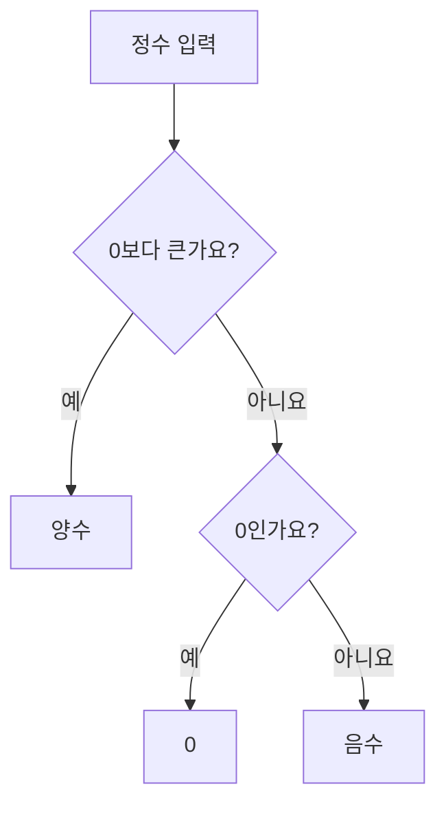

# 03 · 조건에 따라 다르게 출력하기

[← Python 기초 목차](../README.md) · [랩 목록](../labs/README.md)

**배울 것:** 정수가 양수·0·음수인지 판단하고 짝수·홀수를 구분합니다.

## 조건은 맞는지 아닌지 판단하는 식입니다

`number > 0`은 number가 0보다 큰지 묻는 식입니다. 맞으면 True, 아니면 False가 됩니다. if 뒤의 조건이 맞으면 들여쓴 코드를 실행합니다.

| 비교 | 뜻 | 예 |
|---|---|---|
| `>` | 크다 | `3 > 0` → True |
| `<` | 작다 | `-2 < 0` → True |
| `==` | 같다 | `0 == 0` → True |
| `!=` | 다르다 | `3 != 0` → True |

**`=`는 저장, `==`는 비교**입니다. if·elif·else 줄 끝에는 콜론을 적고, 그 안에서 할 일을 한 단계 들여씁니다. VS Code의 기본 들여쓰기를 그대로 사용합니다.

## 위에서부터 조건을 확인합니다

양수인지 먼저 보고, 아니면 0인지 보고, 둘 다 아니면 음수라고 출력합니다. 한 번의 if·elif·else 묶음에서는 조건에 맞는 한 갈래를 실행합니다.



## 나머지로 짝수 알아보기

`%`는 나눈 나머지입니다. `4 % 2`는 0, `5 % 2`는 1입니다. 2로 나눈 나머지가 0인지 비교하면 짝수를 구분할 수 있습니다. 두 번째 예제는 양수/음수 예제와 별개로 읽고, 두 프로그램을 한꺼번에 합치지 않습니다.

## 예제 파일과 예상 결과

각 파일을 따로 열어 ▶ **Run Python File in Terminal**로 실행합니다. 입력을 묻는 경우 아래 Terminal을 클릭해 값을 적고 Enter를 누릅니다. 여러 프로그램을 동시에 실행하지 않습니다.

### 3을 입력한 결과

[positive_or_negative.py](positive_or_negative.py)를 실행합니다. 아래는 문서의 기본값과 안내한 입력으로 실행한 예시입니다.

```text
양수입니다.
```

### 4를 입력한 결과

[even_or_odd.py](even_or_odd.py)를 실행합니다. 아래는 문서의 기본값과 안내한 입력으로 실행한 예시입니다.

```text
짝수입니다.
```

## 다른 입력으로 확인하기

| 파일 | 입력 | 결과 |
|---|---:|---|
| positive_or_negative.py | 0 | 0입니다. |
| positive_or_negative.py | -2 | 음수입니다. |
| even_or_odd.py | 5 | 홀수입니다. |

같은 파일에서 한 번에 하나의 입력을 시험합니다. 조건문이 실행될 때 어느 갈래를 골랐는지 먼저 말로 설명해 봅니다.

## 연결된 랩

[랩 · 양수·0·음수 판단](../labs/03-branching/README.md)에서 한 곳을 바꾸고, 예상 결과와 비교한 뒤 접힌 풀이를 확인합니다.

[다음 단원](../04-lists-and-loops/README.md)
