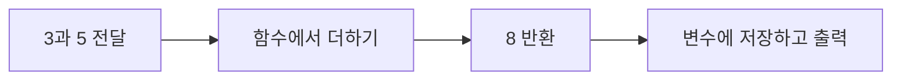

# 06 · 계산을 함수로 묶기

[← Python 기초 목차](../README.md) · [랩 목록](../labs/README.md)

**배울 것:** 두 수를 더하는 기능을 정의하고 다른 숫자로 다시 사용합니다.

## 함수는 같은 기능을 다시 사용하는 방법입니다

앞에서 3 + 5와 10 + 20을 계산했습니다. 이 덧셈을 add_numbers라는 이름으로 묶으면 숫자만 바꾸어 호출할 수 있습니다. `def`는 함수를 정의하고, 괄호 안 first·second는 전달받은 값에 붙일 이름입니다.

```python
def add_numbers(first, second):
    return first + second

result = add_numbers(3, 5)
print(result)
```

이 코드는 8을 출력합니다. 함수 정의만 읽을 때는 안의 계산이 아직 실행되지 않습니다. `add_numbers(3, 5)`로 호출하면 first에 3, second에 5가 들어갑니다. return은 결과를 부른 곳으로 돌려줍니다.



## return과 print는 역할이 다릅니다

return은 다른 계산에도 쓸 수 있도록 값을 돌려줍니다. print는 화면에 보여 줍니다. 처음에는 **함수 안에서 계산해 return하고, 바깥에서 print**하는 형태로 연습합니다. return 자리에 print만 넣으면 호출한 곳이 계산 결과를 받는 동작과 달라집니다.

## 평균도 같은 방법으로 묶습니다

두 점수의 합을 2로 나누던 식을 함수로 옮깁니다. 새로운 리스트나 파일 처리를 동시에 추가하지 않고 함수의 입력·계산·반환만 읽습니다.

## 예제 파일과 예상 결과

각 파일을 따로 열어 ▶ **Run Python File in Terminal**로 실행합니다. 입력을 묻는 경우 아래 Terminal을 클릭해 값을 적고 Enter를 누릅니다. 여러 프로그램을 동시에 실행하지 않습니다.

### 두 번의 함수 호출

[add_function.py](add_function.py)를 실행합니다. 아래는 문서의 기본값과 안내한 입력으로 실행한 예시입니다.

```text
합계: 8
다른 합계: 30
```

### 80과 90의 평균

[average_function.py](average_function.py)를 실행합니다. 아래는 문서의 기본값과 안내한 입력으로 실행한 예시입니다.

```text
평균: 85.0
```

## 다른 값을 전달합니다

add_numbers(3, 5)를 add_numbers(4, 6)으로 바꾸면 첫 합계가 10이 됩니다. 함수를 새로 여러 개 작성하기 전에 같은 함수에 전달하는 수부터 바꿉니다. [함수 값 따라가기](../labs/06a-trace-functions/README.md)에서 반환값을 변수에 저장한 뒤 다른 계산에도 사용합니다.

## 연결된 랩

[랩 · 두 수를 더하는 함수](../labs/06-functions/README.md)에서 한 곳을 바꾸고, 예상 결과와 비교한 뒤 접힌 풀이를 확인합니다.

[선택 참고 · 파일과 JSON](../07-json-and-files/README.md)

함수까지 배웠다면 01의 첫 단원에서 질문과 지시를 문자열로 만드는 복습을 이어갈 수 있습니다. 파일·JSON 실습은 01 시작의 필수 조건이 아닙니다.
