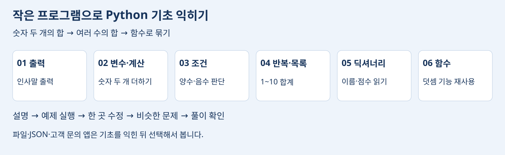

# Python 기초 · 숫자와 이름으로 한 가지씩 배우기

[← 과정 안내](../README.md) · [설치와 첫 실행](../setup/README.md) · [랩 목록](labs/README.md)

**숫자 두 개 더하기, 이름 입력받기, 1부터 10까지 더하기**처럼 목적이 바로 보이는 작은 프로그램부터 시작합니다. 프로그래밍과 업무 상황을 동시에 이해하려고 애쓰지 않아도 됩니다.

## 배우는 방식

설명 읽기 → 완성된 작은 예제 실행 → 한 곳 바꾸기 → 비슷한 문제 직접 풀기 → 풀이와 결과 비교 순서입니다. 처음에는 코드를 한꺼번에 많이 바꾸지 않습니다. 먼저 숫자나 문구 하나를 바꾸어 봅니다.

| 순서 | 배우는 내용 | 직접 해 볼 일 |
|---|---|---|
| [01 · 실행과 출력](01-run-and-print/README.md) | print·문자열·실행 순서 | 인사말과 계산 결과 출력 |
| [02 · 변수·계산·입력](02-variables-and-input/README.md) | 값 저장·자료형·input·int | 두 수의 합, 가격×개수 |
| [03 · 조건문](03-conditions/README.md) | if·elif·else·비교 | 양수/0/음수, 짝수/홀수 |
| [04 · 리스트와 반복문](04-lists-and-loops/README.md) | 위치·for·range·누적 | 숫자 목록 읽기, 1부터 10까지 합 |
| [05 · 딕셔너리](05-dictionaries/README.md) | 키와 값·값 변경 | 이름·나이·점수 읽기 |
| [06 · 함수](06-functions/README.md) | 정의·호출·return | 두 수의 합과 두 점수의 평균 |
| [선택 07 · 파일과 JSON](07-json-and-files/README.md) | 글자 저장·읽기, JSON 관찰 | 짧은 문장을 파일에 저장 |

각 단원에는 설명과 실제 실행할 파일, 예상 결과가 있습니다. 기본 랩에는 작동하는 시작 코드와 주석이 있는 solution.py가 있습니다. 시작 코드는 아직 문제를 해결하지 않은 상태일 수 있습니다. **현재 출력과 수정 후 목표 출력을 구분**합니다.

## 어떻게 실행하나요?

예제의 .py 파일을 열고 ▶ **Run Python File in Terminal**을 누릅니다. 아래 Terminal에 이름·숫자를 묻는 문장이 나오면 해당 창을 클릭해 입력하고 Enter를 누릅니다. 입력을 기다릴 때 ▶를 다시 누르지 않습니다.

00은 기본 Python으로 실행합니다. 가상환경·API 키·외부 패키지 설치는 필요하지 않습니다. 선택 파일 예제의 json·pathlib도 Python에 포함된 기본 기능입니다. 자동으로 실행되면 Python 선택 메뉴를 매번 열지 않습니다.

코드 블록의 Python 문장은 .py 파일에 적고, 예상 출력은 비교할 때만 봅니다. 터미널 명령은 [선택 터미널 연습](../setup/03-terminal-basics.md)을 배울 때 사용합니다. 먼저 ▶ 실행에 익숙해져도 충분합니다.

## 무엇부터 확인할까요?

- 파일을 열고 인사말을 바꿔 다시 실행합니다.
- 입력받은 두 수를 더하고, 다른 숫자로 결과를 확인합니다.
- 조건문이 어느 갈래를 선택했는지 설명합니다.
- 반복문에서 합계가 어떻게 늘어나는지 따라갑니다.
- 딕셔너리의 키로 값을 꺼내고, 함수를 호출해 결과를 받습니다.

한 번에 모두 할 필요는 없습니다. 현재 단원을 이해한 뒤 다음으로 이어갑니다. 오류 읽기·파일·JSON·종합 앱은 관련 기초를 배운 뒤 선택해 복습할 수 있습니다.

## 고객 문의 예제는 언제 보나요?

기초를 익힌 뒤 [선택 고객 문의 응용](optional-customer-questions/README.md)에서 같은 문법이 AI 수업에 어떻게 쓰이는지 살펴봅니다. 00 기본 실습부터 문의 분류·검색·메뉴 앱을 구현하지 않습니다. 01에서는 기초 문법을 모델 입력과 답변에 적용합니다.

AI 도구도 기본 학습을 대신하지 않습니다. 00~03은 직접 작성·실행하고, 04부터 필요하면 Copilot을 참고합니다. Codex는 07부터 선택할 수 있습니다.

[문제 해결](../troubleshooting/README.md) · [Python 공식 튜토리얼](https://docs.python.org/ko/3/tutorial/)

## 00을 마치고 01로 넘어갈 때

00에서는 숫자·이름·점수로 변수·입력·조건·반복·함수를 연습했습니다. 01에서는 같은 문법으로 모델에 보낼 질문을 만들고 답변을 받습니다. **파일·JSON·종합 앱·선택 워크숍을 모두 마칠 필요는 없습니다.**

1. 00 폴더와 직접 고친 파일은 그대로 보관합니다.
2. 선생님의 `ktai-01-llm-basics` 저장소에서 ZIP을 받아 압축을 풉니다. 00 안에 넣거나 00에 덮어쓰지 않습니다.
3. Windows는 `C:\ktai\ktai-01-llm-basics`, macOS는 내 사용자 폴더의 `ktai/ktai-01-llm-basics`를 VS Code에서 새로 엽니다.
4. 01의 README와 `part-01/01-get-ready/README.md`에서 짧은 복습 후 환경을 준비합니다.

00에서 준비한 Python·VS Code·GitHub 계정은 그대로 사용합니다. **01에서 처음 만드는 것은 01의 .venv와 .env**입니다. 라이브러리는 01에서 처음 한 번 설치하고 Part 02·03에는 같은 환경을 사용합니다. Docker Desktop은 Part 03에서 준비합니다. 00에서 미리 설치하거나 API 키를 발급받을 필요는 없습니다.
