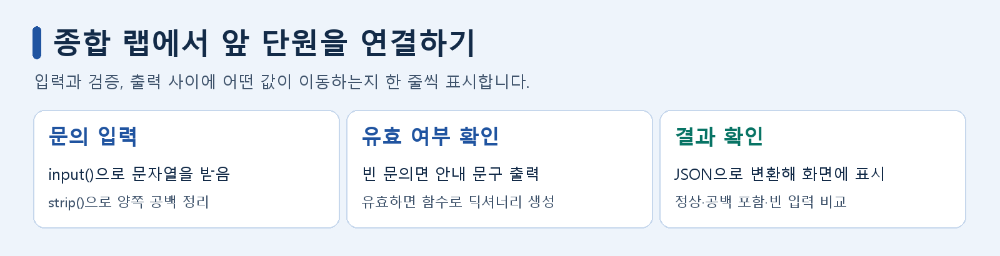

# 선택 종합 랩 08 · 문의 접수 콘솔 앱

**기초 뒤의 선택 응용입니다.** 숫자·이름·점수로 변수·조건·반복·딕셔너리·함수를 익힌 뒤 필요한 부분을 읽습니다. 처음 배우는 학생이 이 앱 전체를 새로 구현하거나 모두 완성해야 다음 교과로 가는 것은 아닙니다.


[← 랩 목록](../README.md)

앞에서 배운 기능을 연결한 문의 접수 앱을 실행하고 읽는 선택 복습입니다. 여기서는 단순 규칙 연습을 위해 요금·계정·기타를 사용합니다. 이후 06~08의 요금·배송·계정 분류 데이터와 다르며, 이 결과를 후속 학습 정답으로 복사하지 않습니다. 코드의 대부분은 준비되어 있으며, 학생은 classify_question()의 계정 분류 두 줄을 완성합니다. 필요한 기능 한 부분만 골라 읽어도 됩니다.



## 시작 코드 실행

실행할 파일은 [starter.py](starter.py)입니다. 파일을 열고 ▶의 **Run Python File in Terminal**로 실행합니다.

<details>
<summary>선택 · 터미널 명령으로 실행하기</summary>

자료 최상위 폴더에서 실행합니다. 아래는 Windows의 py 명령입니다. macOS에서는 python3로 실행합니다.

```powershell
py python-basics/labs/08-helpdesk-app/starter.py
```

</details>

[시작 코드](starter.py)는 메뉴·등록·목록·저장·불러오기가 동작합니다. 계정 분류 TODO만 직접 채웁니다. 새 실행은 빈 목록에서 시작하고, `5`번을 선택하면 저장된 파일을 읽습니다.

## 처음이라면 기능을 한 가지씩 확인

1. 메뉴 1로 요금 문의 한 건을 등록하고 메뉴 2로 읽습니다.
2. 계정 문의를 등록해 기타로 표시되는 것을 확인합니다.
3. classify_question()의 TODO에 계정·비밀번호 조건과 반환을 두 줄 추가합니다.
4. 프로그램을 다시 시작하고 요금·계정 문의를 등록해 분류가 달라졌는지 확인합니다.
5. 저장·불러오기는 아래 검증표를 따라 실행합니다. 처음에는 파일 처리 함수를 작성하기보다 입력과 결과를 읽습니다.

아래 단계는 완성 기능을 이해하는 설명입니다. 스스로 전체를 작성하고 싶을 때 확장 요구사항으로 사용할 수 있습니다.

## 1단계 · 입력과 분류

1. `classify_question(message)`에서 `요금`을 포함한 문의를 **요금**, `계정` 또는 `비밀번호`가 들어간 문의를 **계정**, 그 밖의 문의를 **기타**로 반환합니다. 두 조건이 모두 맞으면 요금을 먼저 선택합니다.
2. `add_question(questions)`에서 앞뒤 공백을 정리하고, 빈 입력은 등록하지 않습니다.
3. `questions`는 리스트입니다. 유효한 문의를 아래 구조로 추가합니다. 번호는 `KT-101`부터 시작해 한 건씩 증가합니다. 이 랩에서는 문의를 삭제하지 않습니다.

```python
{"id": "KT-101", "message": "요금이 많이 나왔어요", "category": "요금"}
```

## 2단계 · 목록과 집계

- `show_questions(questions)`는 번호, 분류, 본문을 한 줄씩 보여 줍니다. 빈 목록이면 안내합니다.
- `show_summary(questions)`는 요금, 계정, 기타 건수와 전체 건수를 보여 줍니다. 입력에 없는 분류는 0건입니다.

## 3단계 · 파일 저장과 복원

1. `save_questions(questions, file_path)`에서 UTF-8로 파일을 열고, `json.dump(..., ensure_ascii=False, indent=2)`로 저장합니다.
2. `load_questions(file_path)`는 `json.load()`로 읽어 문의 리스트를 반환합니다. 파일이 없거나 읽을 수 없으면 안내 후 `None`을 반환합니다. 빈 JSON 목록 `[]`은 정상 결과입니다.
3. 메뉴의 불러오기 분기를 읽습니다. 새 목록은 읽기에 성공했을 때만 기존 목록을 바꿉니다. 연습 파일은 스크립트 옆의 `practice-helpdesk.json`입니다.

## 검증 시나리오

| 순서 | 조작 | 기대 결과 |
|---|---|---|
| 1 | 새로 실행 → `2` → `5` | 빈 목록 안내. 저장 파일이 없다면 안내 후 메뉴가 계속 표시됩니다. |
| 2 | `1` → 공백 세 칸 | 등록되지 않고 다음 문의 번호가 그대로입니다. |
| 3 | `1` → `  요금이 많이 나왔어요  ` → `1` → `계정이 잠겼어요.` | 공백이 정리되고 `KT-101`, `KT-102` 두 건이 추가됩니다. |
| 4 | `2` → `3` | 목록 두 건과 요금 1, 계정 1, 기타 0, 전체 2건이 표시됩니다. |
| 5 | `4` → `q` → 다시 실행 → `5` → `2` | 한글 본문과 번호가 보존되고 이전 두 건이 복원됩니다. |
| 6 | 복원 후 `1` → `상품이 아직 도착하지 않았어요` | `KT-103`이 추가됩니다. |
| 7 | `9` → `q` | 잘못된 메뉴 안내 후 종료할 수 있습니다. |

**제출용 기록** — 실행 명령, 위 시나리오에서 확인한 출력, 해결한 오류 한 가지, 설명할 수 있는 함수 한 가지를 남깁니다. 실습 후 아래 솔루션 링크를 열어 한글 주석과 내 코드를 비교합니다.

**확장 실습** — 목록에 있는 번호로 한 건을 조회하거나, 분류명을 입력해 해당 문의만 표시합니다. 기존 검증 시나리오도 다시 실행합니다.

## 실습 후 답안과 비교하기

먼저 직접 실행하고 요구사항을 시도한 뒤 답안을 펼쳐 봅니다. 답안은 자료에 함께 포함되어 있어 필요할 때 스스로 열 수 있습니다.

<details>
<summary>솔루션 보기 · 실습을 마친 뒤 펼치세요</summary>

[한글 주석이 있는 solution.py](solution.py)를 열고 ▶로 실행합니다. 내가 작성한 파일과 같은 입력을 넣고 결과를 비교합니다. 주석을 읽으며 값이 바뀌는 줄, 조건을 판단하는 줄, 결과를 내보내는 줄을 찾아보세요.

코드가 다르더라도 요구사항의 입력과 결과를 만족하면 가능한 풀이입니다. 차이가 나면 한 줄씩 비교한 뒤 시작 코드로 돌아와 직접 고칩니다.

</details>
