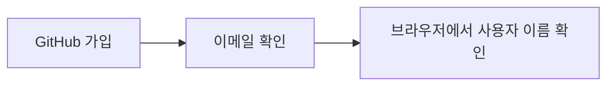

# 00 · GitHub 계정 만들기

[← 설치와 첫 실행](README.md)

수업 자료를 받기 전에 **GitHub 계정부터 준비**합니다. GitHub는 온라인에서 수업 저장소를 열고 초대를 받는 서비스입니다. 이 수업에서는 선생님 자료를 ZIP으로 받아 실습하고, 완성한 파일을 내 GitHub 저장소에 올립니다.

## 1. 가입하고 이메일 확인하기

1. 브라우저에서 [GitHub 가입 페이지](https://github.com/signup)를 엽니다. 계정이 이미 있다면 [GitHub 로그인](https://github.com/login)으로 이동합니다.
2. 가입 화면에서 이메일, 사용자 이름, 비밀번호를 입력하고 화면에 표시되는 확인 절차를 진행합니다.
3. 받은 메일을 열어 GitHub가 안내한 코드나 링크로 이메일을 확인합니다. 메일이 안 보이면 스팸함과 가입에 사용한 이메일 주소를 확인합니다.
4. GitHub 오른쪽 위 프로필 메뉴를 열고 **사용자 이름**을 확인합니다. 자료를 받을 때와 내 파일을 업로드할 때 이 계정을 사용합니다.

## 2. 수업 저장소 접근 확인하기

선생님이 저장소 주소를 공유하면 같은 계정으로 브라우저에서 엽니다. 비공개 저장소라면 해당 계정으로 받은 초대를 수락한 뒤 다시 확인합니다. 브라우저에서 열리지 않으면 자료를 내려받기 전에 주소와 초대 계정을 확인하세요.

**완료 기준** — 브라우저에서 GitHub에 로그인해 내 사용자 이름을 확인할 수 있습니다. 다음은 [VS Code 설치](02-vscode-setup.md)입니다.

[GitHub 공식 계정 생성 안내](https://docs.github.com/en/account-and-profile/how-tos/account-management/creating-an-account-on-github)

## 계정을 다시 확인해야 할 때

자료를 받거나 내 파일을 올릴 때 브라우저의 프로필 메뉴에서 수업용 사용자 이름을 확인합니다.

| 증상 | 다음에 볼 곳 |
|---|---|
| 확인 메일을 찾을 수 없음 | 스팸함과 계정에 입력한 이메일 주소를 확인합니다. |
| 수업 링크가 열리지 않음 | 선생님이 보낸 주소와 초대를 받은 계정의 이름을 대조합니다. |
| 내 프로필은 열리지만 비공개 자료가 안 보임 | 초대가 왔는지 확인하고 수락한 뒤 저장소 주소를 다시 엽니다. |
