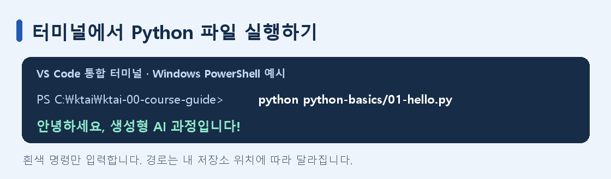

# 선택 · 첫 실행 이후의 터미널 연습

[첫 실행](../python-basics/01-run-and-print/README.md)에서 ▶ 버튼으로 인사말을 출력한 뒤 진행합니다. 이번에는 버튼이 대신 실행하던 명령을 직접 입력해 봅니다.



상단에서 **Terminal → New Terminal**을 선택하면 화면 아래에 명령을 입력하는 영역이 열립니다. 명령만 붙여 넣고 Enter를 누르세요. 화면에 이미 보이는 `PS C:\...>`는 프롬프트입니다.

| 할 일 | Windows PowerShell | macOS |
|---|---|---|
| 현재 폴더 확인 | `Get-Location` | `pwd` |
| 현재 폴더의 파일 확인 | `Get-ChildItem` | `ls` |
| 한 폴더 위로 이동 | `cd ..` | `cd ..` |

경로에 공백이 있으면 큰따옴표로 감쌉니다. Python에서 `>>>`가 보이면 `exit()`로 나와 터미널 명령을 실행합니다.

[VS Code 통합 터미널 안내](https://code.visualstudio.com/docs/terminal/basics)

## 따라 하기 · 명령을 어디에서 실행하는지 확인

이 실습은 [수업 자료를 받은 뒤](04-git-github.md) 진행합니다. VS Code에서 압축을 푼 수업 폴더를 열고 새 터미널을 시작하세요.

```powershell
Get-Location
Get-ChildItem
py python-basics/01-run-and-print/print_examples.py
```

macOS에서는 차례대로 `pwd`, `ls`, `python3 python-basics/01-run-and-print/print_examples.py`를 실행합니다. 첫 두 명령에서 폴더 이름과 `python-basics` 항목이 보인 뒤, 마지막 명령에서 인사말이 출력되는지 확인합니다.

**선택 복습 · 경로 오류 확인** — 저장소 폴더에서 `cd python-basics`로 이동한 뒤 같은 실행 명령을 입력해 보세요. 이미 `python-basics`에 있으므로 상대 경로가 중복됩니다. `cd ..`로 돌아와 다시 실행합니다.
