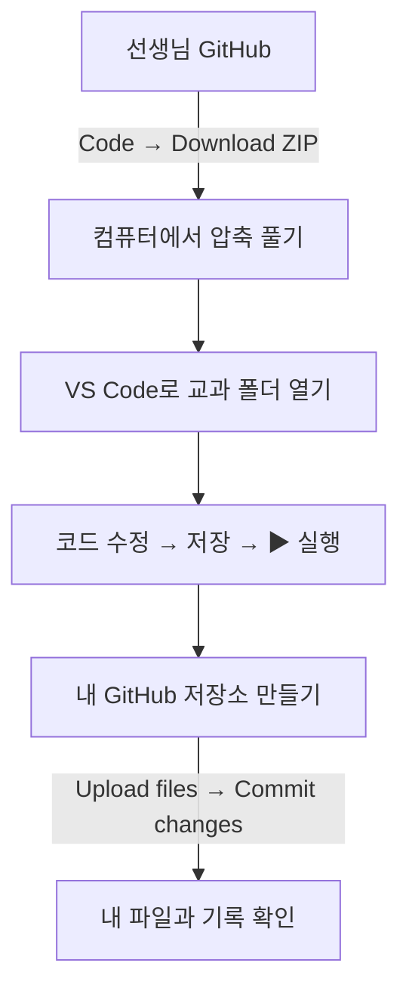

# 수업 자료를 받아 실습하고 내 GitHub에 올리기

[← 설치와 첫 실행](README.md)

선생님 GitHub에서 ZIP 자료를 받고 압축을 푼 뒤 VS Code로 엽니다. 코드를 직접 고쳐 실행하고, 완성한 실습 파일을 내 GitHub 저장소에 올립니다.



## 1. 선생님 자료 받기

1. 브라우저에서 선생님이 공유한 오늘 교과의 GitHub 주소를 엽니다.
2. 첫 준비 자료는 **ktai-00-course-guide**인지 확인합니다.
3. 파일 목록 위의 **Code → Download ZIP**을 누릅니다.
4. 다운로드가 끝나면 브라우저 다운로드 목록에서 파일 위치를 엽니다.

비공개 자료라면 초대를 받은 GitHub 계정으로 로그인하고 초대를 수락합니다.

## 2. Windows · C:\ktai에 자료 준비하기

1. 파일 탐색기에서 **내 PC → 로컬 디스크(C:)**를 엽니다.
2. 빈 곳을 오른쪽 클릭해 **새로 만들기 → 폴더**를 선택하고 `ktai`라는 이름으로 만듭니다. 이미 있으면 사용합니다.
3. 다운로드한 ZIP을 오른쪽 클릭하고 **모두 압축 풀기**를 선택합니다.
4. 압축을 푼 폴더를 열어 README.md와 python-basics가 함께 들어 있는 폴더를 찾습니다. 폴더가 한 겹 더 있으면 안쪽으로 들어갑니다.
5. 그 폴더를 `C:\ktai`로 복사합니다.
6. 복사한 폴더 이름이 `ktai-00-course-guide-main`이라면 `ktai-00-course-guide`로 바꿉니다.

최종적으로 `C:\ktai\ktai-00-course-guide\README.md`가 있어야 합니다. 같은 이름의 기존 실습 폴더가 있다면 보관하고 새 자료를 별도 이름으로 준비합니다.

## 3. macOS · 사용자 홈 아래 ktai에 자료 준비하기

1. Finder에서 **이동 → 홈**을 엽니다. 단축키는 **Shift+Command+H**입니다.
2. **파일 → 새로운 폴더**로 `ktai` 폴더를 만듭니다.
3. 다운로드한 ZIP을 두 번 클릭해 압축을 풉니다. 이미 풀렸다면 그 폴더를 엽니다.
4. README.md와 python-basics가 함께 있는 자료 폴더를 사용자 홈의 ktai로 복사합니다.
5. 폴더 이름이 `ktai-00-course-guide-main`이라면 `ktai-00-course-guide`로 바꿉니다.

사용자 이름이 minji라면 `/Users/minji/ktai/ktai-00-course-guide/README.md`가 있어야 합니다. 자신의 사용자 이름으로 확인합니다.

## 4. VS Code로 열고 실행하기

1. VS Code에서 **File → Open Folder**를 선택합니다. macOS에서는 **File → Open**으로 폴더를 선택할 수도 있습니다.
2. 위에서 준비한 **ktai-00-course-guide 폴더 자체**를 엽니다.
3. 탐색기 바로 아래에 README.md, setup, python-basics가 보이는지 확인합니다.
4. 자료를 신뢰하는지 묻는 경우 선생님이 공유한 주소에서 받은 자료인지 확인하고 진행합니다.
5. [첫 Python 실행](../python-basics/01-run-and-print/README.md)에 따라 인사말을 출력하고, 문구를 바꾼 뒤 저장·재실행합니다.

```text
Windows
C:\ktai\
├── ktai-00-course-guide\
│   ├── README.md
│   ├── setup\
│   └── python-basics\
└── ktai-01-llm-basics\

macOS
/Users/내사용자이름/ktai/
├── ktai-00-course-guide/
│   ├── README.md
│   ├── setup/
│   └── python-basics/
└── ktai-01-llm-basics/
```

다른 교과도 같은 방식으로 받아 ktai 아래에 각각 준비합니다.

## 5. 내 실습 저장소 만들기

1. 브라우저에서 GitHub에 로그인하고 내 사용자 이름을 확인합니다.
2. 오른쪽 위 **+ → New repository**를 누릅니다.
3. **Owner**가 내 계정인지 확인합니다.
4. 이름을 `ktai-00-practice`처럼 교과별로 정합니다.
5. 공개 범위는 선생님이 안내한 제출 기준에 맞춰 **Public** 또는 **Private**를 선택합니다. Public은 누구나 볼 수 있고, Private은 접근 권한이 있는 사람만 볼 수 있습니다.
6. **Add a README file**을 선택하고 **Create repository**를 누릅니다.

## 6. 완성한 파일 올리기

첫 업로드는 직접 고친 Python 파일 한 개로 연습합니다.

1. VS Code에서 수정한 파일을 저장하고 ▶로 정상 실행했는지 확인합니다.
2. 브라우저에서 방금 만든 **내 계정의 저장소**를 엽니다.
3. **Add file → Upload files**를 선택합니다.
4. **choose your files**로 실습 파일을 고르거나, 탐색기·Finder에서 해당 파일을 끌어 놓습니다.
5. 목록에 올리려던 파일만 나타나는지 확인합니다.
6. 변경 설명에 `첫 Python 인사말 수정`을 적습니다. 현재 저장소에 바로 기록하는 항목을 선택하고 **Commit changes**로 완료합니다. 버튼 이름은 화면에 따라 다를 수 있습니다.
7. 파일 목록에서 올린 파일을 열어 바꾼 인사말이 보이는지 확인합니다.

처음에는 직접 작성한 .py 파일과 실습 기록 .md 파일을 골라 올립니다. 자료 폴더 전체를 올릴 때는 .venv·.env·__pycache__·outputs·API 키·비밀번호·실제 고객 자료를 제외합니다. 이후 07·08의 모델 캐시·어댑터 가중치와 개인 data/from-06도 교과 안내에 따라 제외합니다. 브라우저의 파일 업로드에서는 .gitignore가 업로드할 파일을 자동으로 걸러 주지 않으므로 선택 목록을 직접 확인합니다.

## 7. 수정한 결과 다시 올리기와 제출

VS Code에서 수정·저장·실행한 뒤, 같은 저장소의 같은 위치에 같은 이름으로 업로드합니다. 변경 설명을 적고 기록한 다음 브라우저에서 최신 내용을 확인합니다.

선생님이 안내한 곳에 파일 페이지 주소를 제출합니다. Private을 선택했다면 선생님의 접근 권한도 확인합니다.

| 보이는 상황 | 확인할 것 |
|---|---|
| ZIP 안에서 파일이 열림 | 먼저 압축을 풀고 복사한 폴더를 엽니다. |
| VS Code 왼쪽에 교과 폴더만 한 겹 더 보임 | README.md가 들어 있는 교과 폴더 자체를 엽니다. |
| GitHub에 옛 문구가 보임 | 컴퓨터에서 저장한 파일을 다시 올렸는지 확인합니다. |
| 선생님이 제출 링크를 못 엶 | Private 저장소의 접근 권한과 제출 주소를 확인합니다. |

## 다음 날과 새 자료 준비

다음 날은 **File → Open Recent**에서 같은 교과 폴더를 엽니다. 선생님이 자료를 갱신하면 새 ZIP을 별도 폴더에 풀고 기존 실습을 보관합니다. 필요한 실습 파일을 비교한 뒤 이어갑니다.

**완료 확인** — 컴퓨터에서는 내가 고친 파일이 실행되고, 내 GitHub에서는 같은 파일의 최신 내용을 볼 수 있습니다.

[GitHub ZIP 다운로드 안내](https://docs.github.com/en/repositories/working-with-files/using-files/downloading-source-code-archives) · [저장소 만들기](https://docs.github.com/en/repositories/creating-and-managing-repositories/creating-a-new-repository) · [파일 업로드](https://docs.github.com/en/repositories/working-with-files/managing-files/adding-a-file-to-a-repository)

## 이후 VS Code의 Git 기능을 사용할 때 · 설치 확인 참고

이 절은 추가로 VS Code의 Git 변경 기록·Push를 사용하려는 경우의 선택 참고입니다. 00~08의 기본 자료 받기·제출은 ZIP과 브라우저 업로드 안내로 진행할 수 있습니다. Windows는 [Git for Windows](https://git-scm.com/downloads/win)를 설치한 뒤 확인합니다.

1. Windows 시작 버튼을 누르고 `PowerShell`을 검색해 새 창으로 엽니다.
2. 아래 한 줄을 입력하고 Enter를 누릅니다.

```powershell
git --version
```

`git version`과 숫자가 보이면 설치된 상태입니다. 명령을 찾을 수 없으면 PowerShell을 닫고 새로 엽니다. 계속 같은 오류가 나면 설치 완료 여부를 확인합니다. 설치를 마치면 VS Code도 완전히 종료했다 다시 엽니다.

macOS Git 설치가 필요한 수업에서는 [공식 설치 안내](https://git-scm.com/downloads/mac)의 개발자 도구 준비를 따릅니다.
