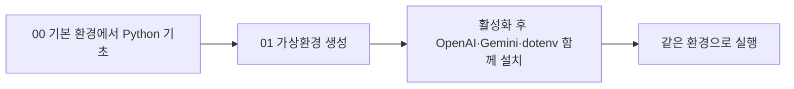

# 가상환경과 pip · 01에서 배우는 내용

[← 00 준비 목차](README.md) · [Python 기초](../python-basics/README.md)

**00은 기본 Python 환경에서 ▶로 실행합니다.** 출력·입력·조건문·반복문과 선택 파일·JSON 예제는 Python에 포함된 기능을 사용하므로 가상환경 생성이나 추가 라이브러리 설치 없이 실습할 수 있습니다.

## 외부 라이브러리가 필요한 시점

01에서 실제 모델을 연결할 때는 OpenAI SDK 같은 외부 라이브러리를 사용합니다. 그때 **01 교과 폴더에 가상환경을 먼저 만들고, 그 안에 라이브러리를 설치**합니다. 자세한 준비는 01의 SETUP.md에서 진행합니다.

| 이름 | 뜻 | 배우는 시점 |
|---|---|---|
| 기본 Python | 컴퓨터에 설치한 Python입니다. | 00의 기초 실습 |
| 가상환경 .venv | 교과마다 추가 라이브러리를 따로 관리하는 환경입니다. | 01의 실제 모델 연결 준비 |
| pip | 라이브러리를 설치하는 도구입니다. | 가상환경을 만든 뒤 |
| requirements.txt | 교과에 필요한 라이브러리 목록입니다. | 목록을 제공하는 교과에서 |

00 예제 위쪽의 import json과 from pathlib import Path는 Python 기본 제공 기능을 불러옵니다. import가 있다는 이유만으로 패키지를 추가 설치할 필요는 없습니다.

01~08은 각 교과 안내에 따라 가상환경을 준비하고 설치와 실행에 같은 환경을 사용합니다. 해당 교과의 requirements.txt는 처음에 전체 설치하며 Part마다 다시 만들지 않습니다. 05·06의 FastAPI 챌린지만 선택 시 별도 환경을 준비합니다. .venv 자체는 GitHub에 업로드할 자료에서 제외합니다.

## 01에서 이어서 준비하기

이 활동은 01의 실제 모델 연결을 준비할 때 해당 교과 폴더에서 진행합니다. 생성과 실행 명령은 01 SETUP.md를 따릅니다. 00의 다음 활동은 [Python 기초 랩](../python-basics/labs/README.md)입니다.

[Python 가상환경 공식 설명](https://docs.python.org/3.12/library/venv.html)
