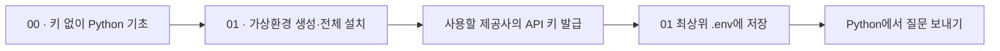

# API 키와 .env · 01에서 준비합니다

[00 준비 목차](README.md) · [Python 기초](../python-basics/README.md)

**00에서는 API 키를 만들거나 입력하지 않습니다.** 기본 Python으로 출력·변수·조건·반복을 익힌 뒤, 01에서 실제 모델 연결을 시작할 때 준비합니다.

## 다음 교과에서 무엇이 달라지나요?

| 이름 | 뜻 | 준비 시점 |
|---|---|---|
| API 키 | 내 계정의 모델 요청임을 확인하는 비밀 값 | 01 OpenAI 연결, 이후 Gemini 연결 |
| .env | 키와 모델 ID를 저장하는 텍스트 파일 | 각 교과의 SETUP 안내에서 |
| .env.example | 실제 키가 없는 입력 양식 | 수업 자료에 제공 |
| .venv | 추가 Python 도구를 담는 폴더 | 01부터 교과별로 한 번 |

01에서는 .env.example을 복사해 같은 폴더에 .env로 이름을 바꾸고 키를 넣습니다. 새 터미널마다 키를 다시 입력하지 않습니다. OpenAI·Gemini·.env 읽기 도구는 첫 설치에 함께 준비합니다.

02~06도 각각의 교과 폴더에 .venv와 .env를 준비합니다. 같은 제공사 키를 다시 사용할 수 있지만, .venv 폴더 전체를 복사하지 않습니다. 정확한 위치와 명령은 해당 교과의 SETUP.md를 따릅니다.

키는 Python 코드·채팅·화면 캡처·GitHub에 넣지 않습니다. 실제 .env는 Git 제외 대상이며 브라우저 Upload files에서도 직접 제외합니다. 코딩 도구 로그인과 수업 코드의 API 키는 별개이며, Copilot은 04부터, Codex는 07부터 이용 가능한 경우에만 선택합니다.

07·08 기본 Qwen 직접 실행·학습은 새 API 키나 .env가 필요하지 않습니다. 07의 선택 API 비교에서만 해당 안내에 따라 키를 준비합니다. 05·06의 FastAPI 챌린지는 선택 시 그 폴더의 별도 .venv·.env를 사용합니다.

00의 다음 활동은 [Python 기초](../python-basics/README.md)입니다. 이 페이지의 용어를 지금 모두 외울 필요는 없습니다.
