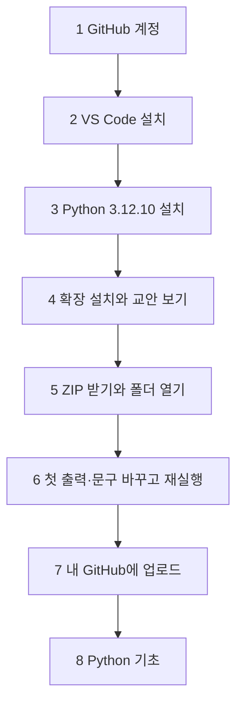

# 설치와 첫 실행 · 처음 시작하는 수업 준비

[← 과정 안내](../README.md)

오늘의 목표는 **수업 파일을 열고 실행해서 인사말을 바꿔 보는 것**입니다. 처음 설치하는 학생은 수업에서 함께 준비합니다. 이미 설치한 항목은 완료 여부를 확인하고 이어가면 됩니다. 아래 순서는 진행 위치를 찾는 안내입니다.

| 순서 | 할 일 | 끝났을 때 보이는 것 |
|---|---|---|
| 1 | [GitHub 계정 만들기](00-github-account.md) | 브라우저의 내 사용자 이름 |
| 2 | [VS Code 설치와 기본 설정](02-vscode-setup.md) | 자동 저장과 읽기 편한 화면 설정 |
| 3 | [Python 3.12.10 설치](01-python-install.md) | 설치 완료 화면 |
| 4 | [Python 확장 설치](02b-vscode-extensions.md) | Microsoft Python 설치 확인. 교안 미리 보기는 자료를 받은 뒤 진행 |
| 5 | [ZIP 자료 받기와 폴더 열기](04-git-github.md) | VS Code 왼쪽에 README.md와 python-basics 폴더 |
| 6 | [첫 Python 실행과 문구 바꾸기](../python-basics/01-run-and-print/README.md) | 화면 아래에 내가 바꾼 인사말 |
| 7 | [내 GitHub에 업로드](04-git-github.md#6-완성한-파일-올리기) | 내 GitHub에서 수정한 인사말 확인 |
| 8 | [Python 기초](../python-basics/README.md) | 변수와 입력으로 만든 작은 프로그램 |

00~03은 직접 코딩합니다. 04부터 필요하면 Copilot을 참고하며, 07부터 Codex 앱도 선택할 수 있습니다. 도구 설치·로그인은 기본 실습의 필수 조건이 아닙니다. Docker Desktop은 해당 실습을 진행하는 교과에서 준비합니다.

## 첫 실행 이후에 배우기

실습 파일을 수정한 뒤 [내 파일을 GitHub에 올리기](04-git-github.md#6-완성한-파일-올리기)를 진행합니다. 컴퓨터에 저장하는 것과 GitHub에 올리는 것을 순서대로 확인합니다.

[터미널 연습](03-terminal-basics.md)은 선택 활동으로, 실행 버튼이 대신 입력한 명령을 직접 실행해 보는 활동입니다. 가상환경 생성과 pip 설치 실습은 01의 실제 모델 연결 준비에서 진행합니다. [개념 참고](05-venv-and-pip.md)는 필요할 때 읽습니다. 00은 기본 Python 환경으로 실행합니다. [API 키](06-env-and-api-keys.md)는 실제 모델을 연결하는 수업에서 설정합니다.

## 화면으로 준비 완료 확인하기

- [ ] VS Code 왼쪽에 수업 자료의 README.md가 보입니다.
- [ ] Python 파일을 열어 실행 버튼을 눌렀습니다.
- [ ] 아래쪽 Terminal에 인사말이 나왔습니다.
- [ ] 문구를 바꾸고 저장한 뒤 다시 실행해 바뀐 문구를 확인했습니다.
- [ ] 업로드 후 내 GitHub에서도 수정한 파일을 확인했습니다.

막히면 현재 페이지 이름과 화면에 보이는 안내를 선생님에게 알려 주세요. [문제 해결](../troubleshooting/README.md)

Python 기초 뒤에는 [00→08 연결 안내](../README.md#00부터-08까지-이어가기)에서 다음 교과 폴더와 환경이 어떻게 달라지는지 확인합니다.
